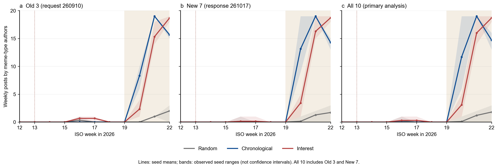
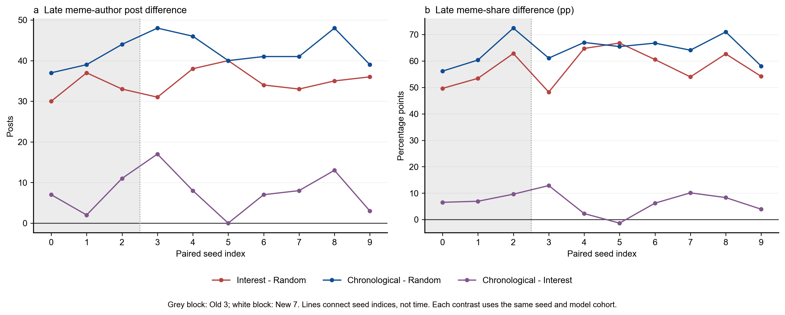
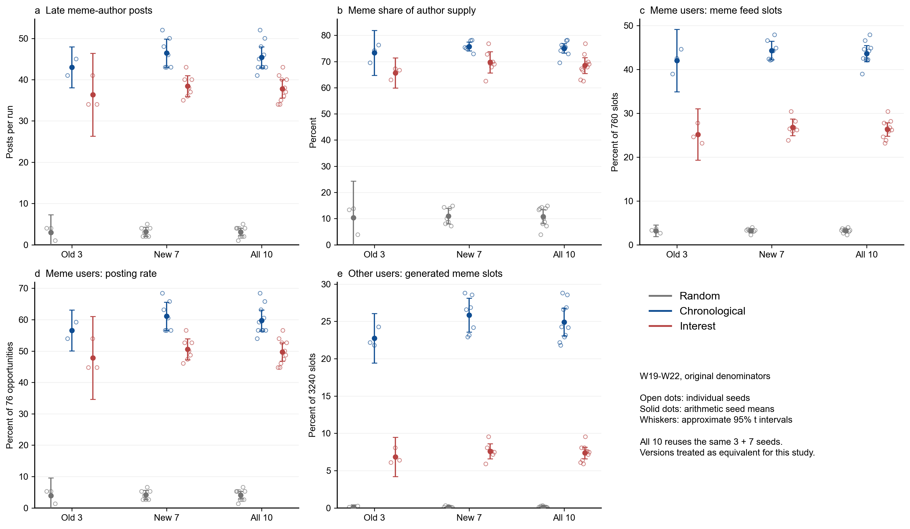

# 三臂各10个seed主实验：补齐种子后的稳定性

假设4 · 实验2 · timestamp_v1 · 主实验30次完整运行 · 2026年10月23日分析，10月24日解释修订

**按用户明确采纳的研究约定，新旧模型在本研究中视为等价，三臂各10个seed合并作为主分析；具体版本号仅用于溯源。**补齐后，兴趣与时序均高于随机的方向稳定，时序完整制度的晚期指标总体更高。但时序臂同时包含更快的生成帖入池和周内回流，以及不同候选规则，当前结果不能单独归因于“时序排序”。

## 1. 研究范围与原口径

本轮只分析三臂主实验，每臂seed0–9共10次，不更新消融，不重跑仿真。分析沿用原论文图3/4与`paper/figures/scripts/prepare_simulation.py`的作者供给和接触口径：以成功`posted`的作者`agent_type`归类，不对正文独立做语义分类。外部、官方和初始池帖子不进入Agent供给；接触指标则遵守各自来源定义，不能一概排除外部帖子。

核心窗仍为W19–W22。每个run先计算晚期玩梗作者帖数占全部Agent发布帖的比值，再按seed平均；不是把30次帖数混池后求比。玩梗群体所见玩梗占比包含外部与生成的`type=meme`条目，分母为760个数值feed槽；玩梗群体发帖率分母为76个Agent×周机会；跨群体再展示只计`source=agent, type=meme`，分母为非玩梗Agent的3240个槽位。10个数值feed槽不等于正文生成提示中读取的前5条；实际再展示也不等于回流机制的独立净贡献。

### 设计解释：外部真实帖同资格，生成帖入池不同

这是当前比较的主要归因限制。[`curation_arrival_schedule.py`第61–62行](../../custom/envs/curation_arrival_schedule.py#L61)中，timestamp模式下外部真实帖三臂均按相同`published_at`取得资格；这不保证三臂展示相同内容。差异发生在生成帖提交和候选选择。

| 设计环节 | 时序 | 随机／兴趣 |
|---|---|---|
| 外部真实帖到达资格 | 相同published_at | 相同published_at |
| Agent生成帖可用时间 | 当前批末入池，后续小时批次可见 | 延迟至次周周界可见 |
| 当前批反馈 | feed快照已冻结，不回改本批 | feed快照已冻结，不回改本批 |
| 候选／选择规则 | 已入池候选按发布时间倒序 | 随机抽样／兴趣活跃候选与保底、活力等规则 |

[`step()`第278–297行](../../custom/envs/curation_arrival_schedule.py#L278)明确以推荐制度决定生成帖`available_at`，候选与feed规则见[第131–173行](../../custom/envs/curation_arrival_schedule.py#L131)。因此时序臂代表“排序＋生成帖更快入池／周内回流＋候选规则”的制度组合；外部帖同资格不消除这一差异。现有三臂结果不能量化各机制的独立贡献，本轮不通过修改消融或重跑来拆解。

## 2. 数据与核验

纳入30次完整运行、330个run×week和3000份Agent工作区，共6041篇成功发布帖。每次完整运行包含100名Agent、11周、693步、1100次唯一环境行动及完整唯一无失败决策。统计重复单位是seed，不能将3000份工作区或33000次Agent×周决策当作独立样本。

| 数据层 | 本轮范围 | 核验用途 |
|---|---:|---|
| run级 | 30行 | 三臂各10seed，原五指标 |
| 周级 | 330行 | W12–W22轨迹与晚期窗 |
| Agent工作区 | 3000份 | posted、作者类型、决策与接触记录 |
| 成功发布 | 6041篇 | 完整科学结果中的帖数 |

[EDA快速统计](data/seed10_quick_stats/eda_quick_stats.md)和[探索核验说明](data/seed10_explore.md)记录行数、指标分布及原口径复验；[证据索引](data/evidence_index.json)汇集来源。旧9次原周表与原论文图3/4的逐run指标逐格复现通过。本报告只采用`seed10_*`本轮资产，索引内其他历史分析不进入结果。

恢复路径按[来源清单](data/seed10_sources.json)固定：兴趣seed6采用`timestamp_v1_interest_s6_resume1`，随机seed7采用`timestamp_v1_random_s7_retry1`。原失败随机seed7的224次行动、54帖和54次正文请求留作运行证据，不纳入完整科学结果；兴趣seed6原目录与接续副本不重复计数。运行预算中的历史请求与本报告的科学结果是两个口径。

## 3. 发现一：兴趣、时序相对随机的方向保持

`seed10_c1`：沿用W19–W22作者供给口径，兴趣与时序均高于随机，新增7seed和合计10seed方向一致。核心指标中的这两组配对差，在10个seed上均为正，新增seed3–9单独为7/7正。以下均值以seed为单位，每臂n=10。

表1：合计10个seed的W19–W22均值；百分比按各run原分母计算后平均。

| 指标 | 随机 | 时序 | 兴趣 |
|---|---:|---:|---:|
| 晚期玩梗帖数 | 3.100 | 45.400 | 37.800 |
| 玩梗供给份额 | 10.780% | 75.011% | 68.472% |
| 玩梗群体所见玩梗占比 | 3.224% | 43.632% | 26.316% |
| 玩梗群体发帖率 | 4.079% | 59.737% | 49.737% |
| 跨群体生成玩梗再展示占比 | 0.114% | 24.920% | 7.373% |

兴趣相对随机的晚期供给份额平均差为+57.692个百分点，配对均值t近似95%区间为52.978–62.406；时序相对随机为+64.231个百分点，区间60.413–68.049。补种子后的变化主要是对原方向增加了重复证据，没有出现兴趣或时序跌至随机以下的seed。

图1：W12–W22玩梗作者周供给；旧3、新7与合计10的方向相同，阴影为实际seed极差而非置信区间。

这里的稳定指晚期上升和制度排序，具体转折周可相差一周。按周均最大作者供给类别，时序在旧3与新7均从W20起玩梗居首；兴趣旧3从W21、新7从W20、合计10从W21。W12三臂最大作者供给均为营销，因此不把现实“教育→悼念→玩梗”三段过程宣称为本轮完整复现。

作为描述性补充，时序和兴趣在10/10个seed中的悼念作者供给峰都位于W13，随机的峰常向后移动。该轨迹与事件时点响应一致，但不是新增的机制因果识别，也不替代晚期主指标。

## 4. 发现二：时序总体高于兴趣，存在单seed例外

`seed10_c2`：时序在同类所见和跨群体生成玩梗帖再展示上高于兴趣；供给份额为9/10正差、1/10反向，不支持兴趣最强。时序相对兴趣的晚期玩梗帖数和发帖率均为9正1平，持平发生在seed5；晚期供给份额在seed5反向−1.347个百分点，其余9个seed为正。同类所见和跨群体生成玩梗再展示则均为10/10正差。

时序减兴趣的晚期供给份额均值为+6.539个百分点，配对t近似95%区间3.592–9.487。时序的玩梗群体所见占比43.632%，兴趣为26.316%；跨群体生成玩梗再展示24.920%对7.373%。这些数字描述完整策展配置的制度差异，不能归因于时序排序本身；生成帖更快入池和后续小时周内回流与排序、候选规则同时存在，现有数据无法量化各自贡献。

图3：同seed配对差值显示兴趣、时序均高于随机；时序相对兴趣的供给份额在seed5反向，其余9个seed为正。

逐个剔除任一seed后，五指标与三组配对的均值方向全部保持为正。这说明总体排序并非由某一个seed单独决定；它不表示每个单seed比较都严格大于零，也不能据此拆分时序排序与生成帖入池等机制。

## 5. 批次溯源与补充稳健性

`seed10_c3`：按用户确认将新旧模型版本视为本研究等价，三臂各10seed合并作为主分析；旧3与新7制度排序一致，分批结果作为补充检查，精确版本标识保留溯源。溯源记录为：旧seed0–2请求`deepseek-v4-1-flash-260910`、实际返回无日期别名`deepseek-v4-1-flash`；新增seed3–9请求`deepseek-v4.1-flash`、实际返回`deepseek-v4-1-flash-261017`。

表2：旧批seed0–2，每臂n=3。

| 指标 | 随机 | 时序 | 兴趣 |
|---|---:|---:|---:|
| 晚期玩梗帖数 | 3.000 | 43.000 | 36.333 |
| 玩梗供给份额 | 10.324% | 73.300% | 65.614% |
| 玩梗群体所见玩梗占比 | 3.202% | 42.018% | 25.175% |
| 玩梗群体发帖率 | 3.947% | 56.579% | 47.807% |
| 跨群体生成玩梗再展示占比 | 0.113% | 22.737% | 6.842% |

表3：新增seed3–9，每臂n=7。

| 指标 | 随机 | 时序 | 兴趣 |
|---|---:|---:|---:|
| 晚期玩梗帖数 | 3.143 | 46.429 | 38.429 |
| 玩梗供给份额 | 10.975% | 75.745% | 69.697% |
| 玩梗群体所见玩梗占比 | 3.233% | 44.323% | 26.805% |
| 玩梗群体发帖率 | 4.135% | 61.090% | 50.564% |
| 跨群体生成玩梗再展示占比 | 0.115% | 25.855% | 7.601% |

新增7个seed中时序、兴趣的晚期供给份额均值为75.745%和69.697%，旧3个为73.300%和65.614%，随机分别10.975%与10.324%。这些分层值维持定性顺序，用于说明补齐前后的方向一致。合计10是主分析，包含旧3与新7，不作为第三个独立队列重复计算。

图2：W19–W22五项原指标按运行批次补充分层；兴趣和时序高于随机，合计10包含旧3与新7而非独立队列。

图2的误差棒取未截断的t近似95%区间；纵轴从0起，旧3随机臂部分负下界不在图内。完整未截断区间见`seed10_arm_summary.csv`；负下界来自无界近似，不表示负发帖或负比例。

## 6. 统计解释与结论边界

每个层次分别对五指标×三组配对共15项实施精确双侧符号翻转检验，并作Holm多重比较校正。精确指全枚举符号组合，仍要求零假设下配对差符号可交换或差值对称；不是无条件的因果检验。玩梗帖数与发帖率线性相关，15项校正包含冗余，较保守。t均值区间是小样本分布近似，未作同时区间校正。

| 分层 | 每臂seed数 | 15项Holm校正p值 | 可支持的解释 |
|---|---:|---:|---|
| 旧3 | 3 | 均为1 | 方向一致，检验分辨率低 |
| 新7（补充） | 7 | 均为0.234375 | 方向同向，子集未单独过0.05校正 |
| 合计10（主分析） | 10 | 均为0.029296875 | 十seed配对比较支持制度差异 |

**按本研究的模型等价约定，合并十seed主分析支持兴趣、时序相对随机的方向稳定；时序完整制度晚期指标总体更高，“兴趣最强”不成立。**新增7个seed的补充结果同向，但其15项校正未单独过0.05。最重要的解释边界是时序排序与生成帖更快入池／周内回流、候选规则同时变化；这些结果不能告诉我们各机制分别贡献多少。

外推仍限于本次100人、11周和冻结参数下的完整策展制度。作者类型不等于正文被独立确认为玩梗；数值槽位接触不等于实际阅读或现实用户曝光；生成帖再展示不等于反馈的净因果贡献。消融本轮未动，因此机制拆解仍沿用此前证据边界。本轮未新增条件、重跑仿真或修改原始结果。

## 7. 附录：可复核资产

| 文件 | 用途 |
|---|---|
| [seed10_runs.csv](data/seed10_runs.csv) | 30次完整run与模型标签、原五指标 |
| [seed10_weekly.csv](data/seed10_weekly.csv) | 330个run×week原口径周表 |
| [seed10_arm_summary.csv](data/seed10_arm_summary.csv) | old3/new7/all10分层均值及区间 |
| [seed10_paired_contrasts.csv](data/seed10_paired_contrasts.csv) | 配对差、方向计数、精确检验、Holm与逐一剔除 |
| [seed10_sources.json](data/seed10_sources.json) | 实际run目录、来源校验和、模型返回与分母 |
| [seed10_metrics.sqlite](data/seed10_metrics.sqlite) | 30行run表与330行周表 |
| [证据索引](data/evidence_index.json) | 图、数据、主张的追溯入口 |

图1–3使用同一组30次完整结果；中英文报告图表与数值完全对应。三图分别服务于轨迹、运行批次补充稳健性、逐seed配对，不构成额外实验。
