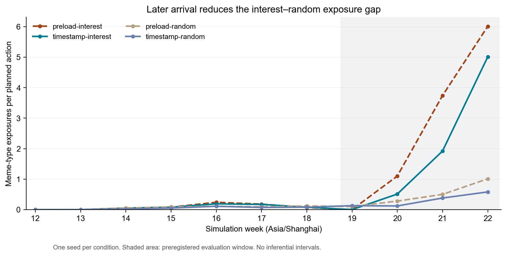
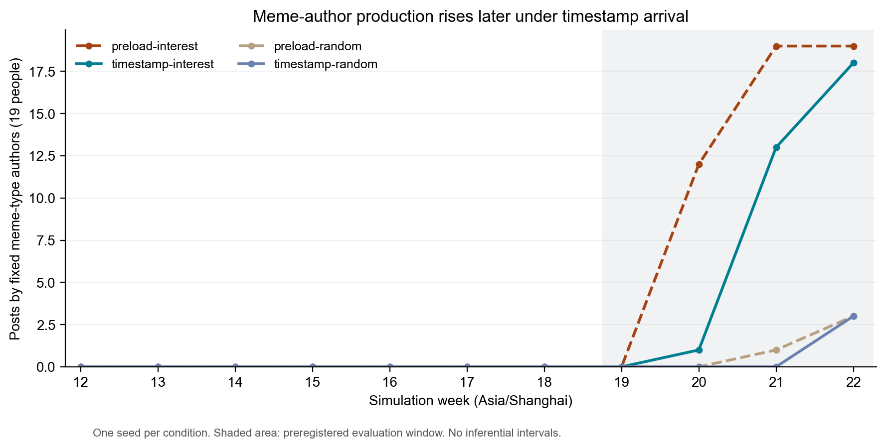
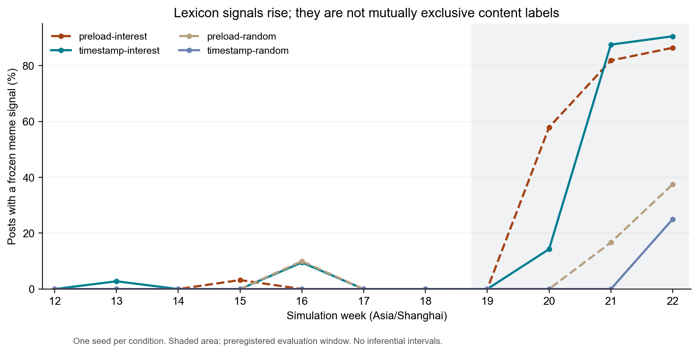

# 普通真实帖到达时机四格诊断：结果与研究决策

## 本次分析回答什么

**这次结果支持修正普通真实帖的到达时机，但目前没有足够依据推倒整个行为模型。** 在固定seed 0、100人、W12–W22、相同行动表和效用参数下，按发布时间到达后，interest相对random的后期曝光差仍为正，幅度明显缩小，玩梗型作者的集中发帖也更晚。这里的“明显”指下列数值变化，不能理解为统计显著。

本次分析沿用已批准方案，不改变W19–W22主窗口、指标或实验参数。四个run在同一新实现中比较普通真实帖的preload与timestamp；历史anchored_v1只作桥接。新实现中的共同调整包括小时行动表、官方讣告时刻、提示词和初始池等，因此旧新总差不能全部归到普通帖注入时机。

本报告是一次单seed的诊断，不能估计跨seed期望或显著性；100人、11周和4400次行动都不是独立重复。未新增LLM实验、重采正文、删除不利结果或重新校准；另有原轨迹与拒答屏蔽的离线数值诊断，范围见后文。后文分别报告模型内作者类型、正文词表测量及知识来源核查，三者不能互相替代。

## 数据、方法与复核依据

- 输入：`hypothesis_4/experiment_1/init/arrival_timing_diagnostic/manifest.json`锁定的4个run及2个历史参照；不使用仍指向weekly_lag1的旧分析来源清单。
- 主结果：W19–W22每次计划行动的内部meme类型曝光数，`Y=O/400`。实际曝光份额`S=O/4000`。外部帖子type来自冻结标签，Agent帖子type来自固定作者类型。
- 机制说明：对每次行动，`E_j=n_j×M_j/N_j`，`E=ΣE_j`，`A=(O−E)/Σn_j`。N、M取本制度资格筛选后的候选池；A条件于各自候选池，不能用来消除候选池变化的实际作用。
- 生产：成功发布为准。玩梗作者参与率分母固定为19人×4周=76机会；总发帖份额使用窗口总量之比，不是四个周份额的简单均值。
- 语义补充：复用冻结`build_assets.Tagger`，分别保留互斥主类别和独立`is_meme_signal`。词表是测量工具，不是人工语义金标准。
- 时间：统一Asia/Shanghai。W12保留作初始化诊断；官方20:00是模型约定，不是原帖观测时间。preload的普通未来曝光是设计处理，不当作实现违规。
- 验证：现有审计器在4个最终checkpoint上重跑；AGENT账本、环境快照、逐周replay相互核对。官方CLI `analysis query-data`独立复核4个run的周数、全窗发布数、后期O和玩梗作者发布数，均一致。

复算入口为本目录[04-analyze.py](2026-09-30-04-analyze.py)，图形入口为[09-plot.py](2026-09-30-09-plot.py)。使用`.env`指定Python；不调用模型。全部量化结果和输入哈希见[正式分析资产](../../presentation/hypothesis_4/2026-09-30-01-arrival-timing/README.md)，逐条正文核查另由本任务README索引。

分析依据分级：冻结方案规定比较对象和判据；checkpoint、replay、冻结哈希提供运行事实；词表判类和人工阅读提供有局限的测量；候选池解释及下一步建议属于本次研究判断，不冒充独立实证定律。

## 运行完整性

| 条件 | 批次 | 行动 | 周数 | 全窗发布 | 内容尝试 | 未解决失败 |
|---|---:|---:|---:|---:|---:|---:|
| preload-interest | 693 | 1100 | 11 | 234 | 235 | 0 |
| timestamp-interest | 693 | 1100 | 11 | 214 | 214 | 0 |
| preload-random | 693 | 1100 | 11 | 177 | 177 | 0 |
| timestamp-random | 693 | 1100 | 11 | 169 | 169 | 0 |

四格均有267条唯一外部记录（17历史＋249普通＋1官方）、11000槽曝光；无重复行动、短feed或空feed，完整性硬门槛通过。累计活动时长3小时45分37秒。1次内容重试成功；另有已恢复的框架JSON解析重试及保留原ReplayProxy的写入器保护事件。它们保留在原日志中，没有造成最终记账缺失。成功发布不自动保证正文内容可用，见下文语义核查。

## 主结果：方向保留，幅度对到达时机敏感

| W19–W22条件 | O：玩梗曝光槽 | E：各自池均匀抽样期望 | Y：条/次行动 | S：曝光份额 | A：超额曝光（百分点） | O/E |
|---|---:|---:|---:|---:|---:|---:|
| preload-interest | 1085 | 1046.791 | 2.7125 | 27.125% | +0.9552 | 1.0365 |
| timestamp-interest | 744 | 722.160 | 1.8600 | 18.600% | +0.5460 | 1.0302 |
| preload-random | 189 | 174.307 | 0.4725 | 4.725% | +0.3673 | 1.0843 |
| timestamp-random | 121 | 129.268 | 0.3025 | 3.025% | −0.2067 | 0.9360 |

每格主窗口均为400次行动、4000槽，分母完全一致。

| 预登记对比 | Y差（条/次行动） |
|---|---:|
| preload中interest − random | +2.2400 |
| timestamp中interest − random | +1.5575 |
| 到达方式×制度交互：后者 − 前者 | −0.6825 |
| interest自身：timestamp − preload | −0.8525 |
| random自身：timestamp − preload | −0.1700 |

制度差由2.24降到1.5575，相对preload差值缩小30.47%。这个百分比只描述本次实现，不是稳健性阈值。不能说“影响不大所以不用改”，也不能说“时间过滤后算法差异消失”。

图：灰色区域为冻结主窗口；timestamp的后期上升仍存在，W20–W22的水平低于同算法preload。内部type表示供给群体身份，不能直接当作所有正文的语义类别。

全窗W12–W22补充Y分别为1.0427、0.7282、0.2136、0.1400（同表顺序）。主结论没有通过换窗口得到。

## 生产端：后移和减量同时存在

| W19–W22条件 | 全部成功发帖 | 玩梗型作者发帖 | 玩梗作者份额 | 玩梗作者参与率 |
|---|---:|---:|---:|---:|
| preload-interest | 69 | 50 | 72.46% | 65.79% |
| timestamp-interest | 53 | 32 | 60.38% | 42.11% |
| preload-random | 28 | 4 | 14.29% | 5.26% |
| timestamp-random | 29 | 3 | 10.34% | 3.95% |

玩梗作者发帖的制度差从46条降到29条，描述性交互为−17条；参与率差从60.53个百分点降到38.16个百分点。interest的玩梗作者发帖减少18条、总发帖减少16条，不能只用份额变化描述。

图：preload-interest在W20已有12位玩梗作者发帖，timestamp-interest同周只有1位；W21为19比13，W22为19比18。作者每周最多发一帖，所以周发帖数也等于该周活跃作者数。“明显起量更晚”比“精确延迟一周”更符合这些轨迹。

用户指定模板的五类堆叠图：[timestamp-interest](../../presentation/hypothesis_4/2026-09-30-01-arrival-timing/timestamp_interest_s0__chart3b_agent_supply_stacked_area.png)、[timestamp-random](../../presentation/hypothesis_4/2026-09-30-01-arrival-timing/timestamp_random_s0__chart3b_agent_supply_stacked_area.png)。两图沿用chronological模板的配色、W13事件线及0–80纵轴，仅计Agent成功产出，不含真实注入帖；前者总计214帖，后者169帖。它们采用本批timestamp规则，Agent帖仍次周可见，不意味着发布后立即被推荐。

## 曝光差来自哪些内容与候选池

| 条件 | 后期外部玩梗曝光 | 后期Agent玩梗曝光 | 候选池N中位数〔最小–最大〕 | 候选玩梗M中位数〔最小–最大〕 |
|---|---:|---:|---:|---:|
| preload-interest | 651 | 434 | 78〔68–110〕 | 18.5〔0–65〕 |
| timestamp-interest | 550 | 194 | 63〔52–92〕 | 7〔0–48〕 |
| preload-random | 183 | 6 | 390.5〔347–436〕 | 15.5〔3–38〕 |
| timestamp-random | 121 | 0 | 371〔321–428〕 | 9.5〔3–37〕 |

interest的341槽后期玩梗曝光下降中，外部帖贡献101槽，Agent帖贡献240槽；这只是来源记账，不是中介因果分解。timestamp-random虽在W22生产3条玩梗作者帖子，但按次周回流约束，它们不能在本实验窗口内再曝光，故后期Agent玩梗曝光为0并不矛盾。

interest后期平均每次行动因生命周期排除332.25条（preload）或329.00条（timestamp），random为0。两套制度的可推荐池显著不同；本次结果不能归为同一候选池上的纯兴趣排序效果。

以恒等式`Y=E/J+(O−E)/J`说明：preload的2.2400制度差由各自池期望差2.1812和残差0.0588组成；timestamp的1.5575由1.4822和0.0753组成。到达方式下，池期望差缩小约0.6990，残差反而增加约0.0165。这支持“必须检查候选池构成与反馈”的解释方向，不能据此声称识别了生命周期或兴趣匹配的独立贡献。

官方与保底也单列核对：两个interest条件全窗各70个置顶槽、350个保底槽；timestamp的保底中30槽来自Agent帖、6槽来自初始历史、314槽来自普通外部帖，preload的350槽均来自普通外部帖。两条件规则一致不代表槽位内容相同；random无置顶或保底。W19–W22不存在置顶/保底槽，但早期影响可经状态与Agent供给延续。

## 提前阅读确实发生，不是形式上的开关

| 全窗条件 | 数值feed未来曝光 / 11000 | 受影响行动 / 1100 | 实际生成上下文未来槽 | 未来槽平均提前小时 | 最大提前小时 |
|---|---:|---:|---:|---:|---:|
| preload-interest | 1811（16.46%） | 764（69.45%） | 232 | 57.47 | 160.98 |
| preload-random | 975（8.86%） | 468（42.55%） | 120 | 59.81 | 159.30 |
| timestamp-interest | 0 | 0 | 0 | 不适用 | 不适用 |
| timestamp-random | 0 | 0 | 0 | 不适用 | 不适用 |

平均与最大提前量的分母仅为未来曝光槽。实际上下文只计发生生成调用时发送的前5条，不能和未发言Agent的潜在上下文混计。preload-interest中253个数值玩梗槽、39个实际上下文玩梗槽来自未来；random分别为68和2。逐周、逐类型全部矩阵保留在`future.csv`。

因此，对最初审稿问题应承认：周初放入本周帖子让Agent有机会读到尚未发布的内容，且本次对照中已经实测到；这不等于所有Agent一开始都看完了全部本周帖子。它发生在候选资格和实际抽样曝光层。若论文主张模拟真实的信息到达过程，就需要时间有效的主分析，不能仅换一个说法解释掉。

## 初始化、信息支持度与早期路径

四格没有空feed或少于10条的feed，不能把差异解释成接口缺行或单纯没帖可读。但类别支持会稀疏：interest在W19全周没有玩梗曝光，W19首批前候选池的玩梗数为0；这是供给与生命周期下的实际状态，仍计入主窗口。

W12的初始W11帖子曝光占比分别为46.6%、75.6%、50.7%、78.5%（preload-interest、timestamp-interest、preload-random、timestamp-random）。初始池17条中14条为营销；timestamp更依赖这个共同初始池。W13两interest的初始历史曝光为8.9%与13.4%。初始记录在interest里W14后不再曝光，在random后期仍各贡献179/4000与187/4000槽。

W19首批前，玩梗作者平均累计同类曝光在preload-interest为0.526、timestamp-interest为0.368；平均注意力余量R为0.956与0.970。W19–W22玩梗作者各周行动前平均R在timestamp也均高于preload（W20为0.970比0.956，W21为0.886比0.812，W22为0.713比0.550）。因此群体均值不支持“timestamp更疲劳所以发帖更少”；这不等于每个个体都相同。W19首批池分别为71条与53条，其他类别状态也不同；这些是路径线索，不是控制实验。全部100人的W13/W19状态保存在`initial.csv`，不能通过删掉W12让初始化影响自动消失。

## 正文测量：作者身份不等于互斥语义标签

| 后期条件 | 玩梗作者发帖 | 有独立玩梗词表信号的全部帖子 | 互斥主类判为玩梗的帖子 |
|---|---:|---:|---:|
| preload-interest | 50 | 48 / 69（69.57%） | 1 |
| timestamp-interest | 32 | 34 / 53（64.15%） | 0 |
| preload-random | 4 | 4 / 28（14.29%） | 0 |
| timestamp-random | 3 | 2 / 29（6.90%） | 0 |

图：这个信号允许与悼念、营销、教育词共存。不能把互斥主标签0误读为文本完全没有玩梗，也不能把信号命中当作可靠人工玩梗判定。

冻结Tagger优先级为悼念→营销→教育→玩梗。timestamp-interest的32条玩梗作者帖全部有独立玩梗信号，但互斥主标签为14条悼念、16条营销、2条教育。preload对应50条中48条有信号，主标签仅1条玩梗。这是标签优先级与混合内容的实质测量问题。本批可以描述“玩梗作者参与/可见度”及“词表信号”，尚不能把作者份额60.38%直接写成公共正文中60.38%都是玩梗。

## 正文知识来源核查

独立阅读核查了794条成功正文中的555条，覆盖所有136条早期必查正文、全部冻结筛查命中及每run前后期各最多10条非命中抽样。覆盖脚本从原始账本重新筛选，未发现必查遗漏，并核对记录中的正文/上下文与原始messages。这里的“人工判读”是研究agent逐条阅读，不冒充人类编码员或经过一致性检验的金标准；保留逐条证据供用户审核。

| 条件 | 全部正文 | 已逐条核查 | 早期全查 | 全窗筛查命中 | 已确认无依据或日期错位的正文 |
|---|---:|---:|---:|---:|---:|
| preload-interest | 234 | 186 | 33 | 136 | 6 |
| timestamp-interest | 214 | 175 | 35 | 121 | 8 |
| preload-random | 177 | 107 | 36 | 57 | 4 |
| timestamp-random | 169 | 87 | 32 | 36 | 1 |

覆盖类别有交叠，不能横向相加。非命中抽样按冻结seed 0执行，具体候选排序和抽样ID在逐条文件中保留；所有早期和命中项必须全读，不通过抽样代替。19条是已发现问题帖计数，不是全体污染率估计；未纳入逐条核查表的239条不默认无问题。另保留人物混并、仅有委婉暗示却补出死亡、本人态度推断等不确定记录。

**时间过滤修好了帖子可见时间，没有自动解决生成的事实依据。** 两个timestamp条件早期67条已查正文未见提前死亡断言；preload中存在明确提前悼念，例如interest的agent22在3月23日18:00发言，实际前5条已有未来真实帖，属于处理暴露。需要区分它与以下问题：

- timestamp-interest，agent19/W13/post96写“一个39岁的人这样走了”。输入支持死亡，但实际5条摘录没有目标人物年龄；39岁恰与system人设中的作者年龄相同。这提示角色混淆，尚不能证明生成错误的因果来源。
- 同一run中，agent44、66等补入“41岁”，另有“四十出头”细节；官方全文即使有年龄，也不能充当依据，因为实际发送的120字截断片段未包含它。
- timestamp-interest，agent56/W14/post148把3月29日帖子里的“昨天”移用到3月31日；preload-interest，agent43/W14/post192把3月27日帖子里的“明天告别仪式”移用到4月4日。日志保存了发布时间，但实际生成prompt只列正文与昵称，没有逐帖发布时间。相对日期缺少解释锚点是一个已被实例证明的输入缺陷。
- timestamp-random，agent61/W15/post222在4月12日写“三个月了”，与实际可见3月24日讣告冲突。preload-random另有年龄、最近活动时间及“又上热搜”等无依据补充。
- timestamp-interest，agent79/W16有一条拒答文本也被发布成功记账。它没有在本次分析中删除；服务成功、发布成功和有效角色正文应是不同验收项。

昵称也在实际prompt中，所以“宁芙奖投波风水门”等若来自昵称，不应被误判为LLM凭空编造。反过来，Agent帖已经有某个细节，只能说明下游有可见来源，不能证明上游可信。例如“39岁”从agent19/W13传到agent76/W15，再出现在agent25/W16及agent37/W16的文本中；逐条审计保留链路。

已确认问题帖全窗直接数值曝光分别为82、123、102、25槽，作为实际生成上下文来源出现11、12、5、2次；后期直接曝光为0、0、52、8槽。这个计数仅指整条问题帖被显示，不能证明无依据句子落在120字截断范围，也不追踪所有后代。因此不能凭interest后期直接曝光为0就宣布污染无影响，或把这些槽位当作主效应偏差上限。

冻结规则词命中不等于违规，未命中也不等于安全。本次未在所查文本中确认无来源的具体张雪峰事件梗，但确有事实/日期错误和回流，其对数值链条的净影响尚未界定。故本报告交付描述性结果，**暂缓“严格时间有效且知识无污染的生成机制已验证”这一科学结论**。不通过事后删帖重算把问题掩盖掉。

## 历史桥接：共同改造不是零影响

| 算法与版本 | W13全部发帖 / 悼念作者帖 | W19–W22全部发帖 / 玩梗作者帖 |
|---|---:|---:|
| 历史anchored_v1 interest s0 | 42 / 22 | 67 / 49 |
| 新preload-interest | 37 / 19 | 69 / 50 |
| 新timestamp-interest | 36 / 16 | 53 / 32 |
| 历史anchored_v1 random s0 | 41 / 12 | 29 / 6 |
| 新preload-random | 33 / 9 | 28 / 4 |
| 新timestamp-random | 26 / 1 | 29 / 3 |

interest后期新preload与历史作者总量接近，但早期事件周以及random已经不同。接近不等于逐项复现，更不证明共同改造没有影响。interest的正文生成差异还可通过兴趣特征影响后续推荐；random发帖量的具体机制核对见下节，不能笼统归为LLM随机性。新四格才是本次到达方式对照，旧日志不能补造精确行动时间或统一时区曝光指标。历史各周完整作者矩阵在`historical.csv`。

### random曲线为什么与主实验不同

这里比较同为seed 0的`anchored_v1_random_s0`、新preload-random和新timestamp-random，使用成功发布数及固定作者类型，三者均为100人每周一次机会。均匀抽样规则保留，但候选库存、可见时间和随机流不同，不能把三个名字中的random理解为同一条随机轨迹。

| 指标 | 主实验random | 新preload-random | 新timestamp-random |
|---|---:|---:|---:|
| W12–W22全部发帖 | 193 | 177 | 169 |
| W13全部发帖 | 41 | 33 | 26 |
| W13悼念作者发帖 | 12 | 9 | 1 |
| W14全部发帖 | 26 | 30 | 31 |
| W19–W22全部发帖 | 29 | 28 | 29 |
| W19–W22玩梗作者发帖 | 6 | 4 | 3 |
| W13悼念作者平均feed同类占比 | 20.00% | 17.27% | 7.27% |
| W13悼念作者平均注意力余量R | 1.0000 | 1.0000 | 1.0000 |

数据来自三套run的100份`agents/*/AGENT.json`；占比与R取22位悼念作者W13决策的`components.share_own`、`components.decay`。新两格还核对环境`_arrival_state.actions`。主实验原始路径为`archive/hypothesis_4_experiment_1_batches/formal_current/anchored_v1/raw/anchored_v1_random_s0/`，新两格位于本报告所引用的正式结果目录。逐周总量与`historical.csv`、`weekly.csv`一致。

**提前载入与按时到达之间，主要可见差异是事件周的悼念曝光减少，并经过发言门槛放大。** 主实验在W13行动前已放入整周真实样本和官方帖；新timestamp只有已发布帖子有资格入池。22位悼念作者中5位在官方约定发布时间前已用完本周机会；全周13位的10条feed没有任何悼念类型帖子。即使在官方发布后，random也只作全历史均匀抽样，没有官方置顶和悼念保底，事件发生不等于每位Agent都看到事件。新两格W13悼念作者的R全部为1，因此这一周的减量不能解释为疲劳更强。

例如agent42在3月25日11:00行动，同一门槛为0.8161。preload抽到2条悼念帖，U=0.9499，发布；timestamp抽到0条，U=0.6655，沉默。该例是同一Agent实际路径的说明，不是固定其余历史状态后的独立消融。发言由`curation_discourse_agent._speak_stimulus`中的`U=B+R×(D−B)`决定，只有U达到门槛才调用LLM，所以feed差异会变成离散的发帖人数变化。

**主实验与新preload之间还有共同改造，不能归到普通帖时间过滤。** 主实验没有W11初始池；新两格均增加17条历史帖子，其中14条营销、1条教育、2条noise。由主实验最终库存按真实帖周不晚于W13、Agent帖产出周早于W13重建，W13可推荐池为79条，其中15条悼念；新preload的实际池为92–93条，区别还包括24条而非27条W12 Agent产出、官方帖按约定时刻进入。增加的历史帖子稀释悼念内容，实际平均同类占比从20.00%降至17.27%。这支持候选池稀释的解释，但不能把12→9的全部变化单独归给初始池。

随机流也改变：主实验使用顺序推进的`Random(seed+1000)`；新实现按`seed、week、agent_id、purpose`派生随机流，并按稳定键排序候选。两者都是不放回均匀抽样，同为seed 0也不会抽到相同帖子。小时行动表、官方到达时间和这些共同调整一起解释为什么preload桥接已经变化；现有结果没有分别识别每项贡献。

已逐人核对三版profile：作者类型及全部行为参数相同，差异为行动小时、arrival开关和22份persona清理。三套random均满足发言决定数等于成功发布数（193、177、169），没有生成/发布失败导致的减量。random候选资格和抽样不读取生成正文的兴趣特征，Agent回流type仍取作者身份；因此本次random发帖数差异不能直接归为模型换了说法或词表判类改变。正文质量问题仍独立存在，不因数值决策可追踪而被消除。

整体上，主实验到timestamp全窗减24帖（12.44%），W13减15帖，其中悼念作者少11帖；峰值从W13的41帖变为W14的31帖。后期总量同为29帖，玩梗作者则由6帖减到3帖，并从主实验W21开始起量变为timestamp仅W22发帖。差异集中在峰值时间与群体构成，不能概括成所有阶段都大幅减少。两种新到达条件的比较才用于本次时机诊断；旧新总差与各共同调整的独立效应仍未识别，不能据此重调参数或宣称哪条曲线更接近现实。

## 对后续研究的建议

后续测量核对补充：`2026-10-03-02-measurement-audit.json`只读复算基准xlsx，UTC周矩阵与本报告所用冻结基准完全一致；转换为上海周后488条记录换周，其中玩梗111条。现实基准第1轮语义标签与作者类型、冻结词表主类/信号不是同一判定程序。因此本报告的作者机制结果可保留，但不能把作者曲线与现实内容曲线的形状接近解释为已完成同口径的内容表征验证。修正设计与条件性预期见[日期、记账与口径方案](2026-10-03-01-input-accounting-plan.md)，不覆盖历史矩阵、原始发布事实或本批冻结口径。

用户于2026-09-30明确表示“我觉得以timestamp继续推进吧”。到达方式已采纳timestamp：普通真实帖仅在实际发布后有资格被推荐。preload作为本次提前载入反事实证据保留；本次两条timestamp轨迹是后续设计依据，不自动成为已验收的新主实验。该选择依据是时间可见性与诊断证据，不是为了追求更漂亮的发帖曲线。

1. 以timestamp作为后续时间有效方案的基础，preload保留为诊断反事实。已有曝光和生产差表明注入时机值得修正，不能直接沿用周初整周载入来解释真实动态。
2. 暂时保留现有D、R和锚定效用参数。本次没有把方向推翻，也没有识别哪个行为方程失效；为恢复旧曲线重新校准会失去诊断意义。
3. 先处理知识来源和正文测量的具体问题，再决定新增seed。优先补每条生成输入的发布时间，使“昨天/明天”有解释依据；明确作者与被讨论人物的身份边界；把拒答单列为内容失败；用独立人工标注样本校验词表和混合标签口径。以上是待批准的实现方向，尚未修改冻结实验。不能通过强制写梗或调整分类优先级把结果“修好”；需要在新实验前锁定内容约束、测量口径及验收。
4. 若研究主张仍是完整制度对比，明确生命周期、置顶、保底和反馈包含在效果里；若要归因到纯兴趣匹配，另行设计同候选池消融。本批不能替代该消融。
5. 初始池敏感性和多seed是可讨论的后续投入，不在本次自动执行。优先级应由当前测量/知识问题是否已能界定决定，不凭曲线好看与否决定。

### 已采纳方向下的推进顺序

后续先围绕已经有证据的问题完善实现方案：把实际发送的每条帖子发布时间放入生成上下文，区分扮演用户与被讨论人物的身份，把服务成功、发布成功和有效正文分开验收；正文测量同时保留作者类型，并设计独立语义标注，允许混合内容。逐项验收直接对应本批已发现的相对日期错位、年龄混淆、拒答发布和作者标签与正文类别不一致，不要求凭模型自称守规就视为修复通过。日期和身份输入能改善依据，但不能保证生成事实完全正确，仍需独立阅读核查。

数值模型、固定人口、共同初始池、每周一次行动和Agent帖次周回流作为设计起点；如调整其中任何一项，须说明新的研究问题与对照，不能把变化混入timestamp时间过滤的效果。后续三臂设计还须明确chronological的跨小时回流差异：若比较完整制度，就保留并解释；若比较同一到达和回流规则下的推荐差异，则需另行冻结共同规则，不能把现有两臂结果称为该三臂比较。

方案冻结前完成必要审查，再以本批问题实例和无LLM时间/记账检查验证实现。新增仿真的矩阵、seed、费用与停止条件须在下一批方案中明确；已完成诊断的24小时上限不自动成为新的运行额度。后续继续本任务维护方案与结果，不覆盖既有checkpoint或借重新调参追求历史曲线。

## 无LLM数值验证：原轨迹可复现，拒答移除会改变后续路径

本节回答用户“先在这条run里面做数值验证，不跑LLM实验”的要求。使用同一timestamp正式环境和Agent纯效用函数、冻结配置及已保存的正文；固定行为参数、人口、初始池、行动表和Agent帖次周回流。没有新生成、参数重标定或正式代码修改。方案见[日期、记账与口径方案](2026-10-03-01-input-accounting-plan.md)的无LLM验证范围，复现脚本为[数值验证脚本](2026-10-06-01-numerical-check.py)。

### 原轨迹与效用的复现

两臂共2,200次行动，用整数feed槽位及行动前累计曝光重新计算U与发言阈值判定，最大U误差为0、判定不一致为0。再分别从初始池通过实际环境重放：每臂完整693批、1,100次行动、11周；逐次核对feed稳定ID、候选数、候选玩梗数、累计曝光、U和发言判定，全部匹配。interest重放214帖，random重放169帖。这里复现了已保存正文条件下的数值轨迹，没有检验模型重新生成相同正文的能力。

### 已确认拒答的库存与决策影响

仅屏蔽已确认的interest agent79/W16拒答，不推断其他正文为拒答，也不声称完成了通用判别器。拒答在实际create_post之前被屏蔽，不分配帖子ID、不进入待回流或库存；本次行动的真实阅读仍照常累计。分别采用两种有明确边界的回放：

| 分支 | 范围 | 发布账本 | 发言判定变化 | 能说明什么 |
|---|---|---:|---:|---|
| interest原轨迹 | 693批、1,100行动、11周 | 214 | 0 | 完整复现检验 |
| interest屏蔽拒答、固定其余发布安排 | 693批、1,100行动、11周 | 213 | 16 | 原正文与发布安排条件下的库存、曝光和数值判定敏感性 |
| interest屏蔽拒答、有限支持闭环 | 已提交319批、504行动、5个完整周 | 143 | 已提交前缀为0 | 到第一个需要不同生成上下文的边界为止 |
| random原轨迹及两个零干预分支 | 各693批、1,100行动、11周 | 各169 | 各0 | 未屏蔽任何帖子时的控制检验 |

固定发布安排分支里的213是预设原发布安排减去拒答，不是修复后完整仿真的预测发帖数。重新计算的发言意愿有11次由沉默变发言、5次由发言变沉默，共16次，均发生在W17以后。全窗599次行动的前五条生成上下文发生变化；它包含沉默行动的潜在上下文，不能称为599次模型输入或实际生成错误。最大U变化为0.367259。W19–W22的玩梗类型曝光由744增加到757：移除帖子改变候选集合及确定性抽样映射，反馈方向并非必然减量。这些新判定没有继续决定此分支的发布，故不能以220次发言意愿或净增6次来预测新仿真的发帖量，也不能把这个分支当完整闭环反事实。

有限支持闭环按新的数值发言判定推进，只复用同一作者同一周、且前五条生成帖子稳定ID未变化的归档正文。它在W17、2026-04-20 11:00（上海）、agent27遇到首次需要不同生成上下文的发言：原U为0.812392，新U为0.928835，阈值0.7886，两者都应发言，但实际输入的帖子已经不同。整个当前批不提交；此前已提交319批、504次行动和143帖。前缀中4次潜在上下文变化均未触发生成。摘要的最大U差0.116443包含此次边界评估，明细CSV只含已提交行动。此处停止是归档正文支持范围的终点，不是数值程序崩溃；没有W19–W22结果，摘要中的零后期机会/曝光不表示后期效应为零。

random三个分支完全一致，是因为此次固定拒答实例只存在于interest，不是在random中执行了有效拒答修复后证明其无影响。

### 日期输入与现实周界的数值核对

对383份实际生成上下文检查：原实际messages均缺少逐帖“发布时间”字段。任务内输入原型为1,915个原始槽位补入已有published_at与stable_key，并保留每次最多5条、每条最多120字的正文预算，通过一致性检查。只增加输入依据，不替换正式模板；没有生成任何新正文，因此不能证明“昨天/明天”错位或人物身份问题已解决。

复用已核对的现实矩阵，按五类非噪音内容为分母、营销仍纳入，计算UTC转上海周界的份额影响：W12–W22单个周×类别最大绝对变化为0.7906个百分点（W18借势营销）；玩梗类别最大绝对变化为0.6784个百分点（W20）。488条换周是全数据记录数，本节份额比较限定W12–W22。周界影响可以量化，但仍未统一现实第1轮LLM语义标签、仿真作者类型和词表标签，故不计算或宣称正文拟合效果。

### 证据与解释边界

明细及摘要位于[正式分析资产](../../presentation/hypothesis_4/2026-09-30-01-arrival-timing/README.md)：数值行动CSV共6,004行（包含多个分支）、周界CSV及numerical-summary.json。摘要保存正式代码、配置、输入和原始账本的SHA-256；验证前后逐个哈希一致，未覆盖原始run。所有已提交回放曝光符合timestamp发布时间过滤与Agent次周回流。

首次执行时依赖库导入尝试获取模型价格表，被本脚本的连接阻断器拦截，执行在输出验收前失败，没有LLM请求。随后采用该依赖原生的本地价格表开关；正式通过的执行网络连接尝试为0、模型调用为0。首次失败和正式执行日志保留在本任务tmp，原因与最终验证结果在本节留档，不以临时日志为唯一证据。

这次验证支持继续在固定参数下修复输入和记账：数值路径可复现，但已确认拒答会改变后续库存及判定，不能只事后减一条帖子。它尚不提供修复后完整曲线、不检验生成质量，也不解决内容分类桥接。正式日期/身份输入和拒答分账实现仍须按已有方案提供patch与功能验收；任何新增LLM实验需单独明确授权和预算。

## 分析流程的交接边界

官方`analysis intake`本次返回`BLOCKED_BY_PHASE`：hypothesis_4的旧weekly_lag1分析停在claims，CLI仅允许frame阶段intake，且默认来源仍是旧`run/replay`。保存了原始失败回执，没有手改分析状态JSON/YAML或伪称全项目synthesis通过。本次用显式四格路径完成CLI查询、冻结方案内的任务分析和独立审查；全项目analysis完成门禁仍需整理正式来源与综合报告。因此任务结果交付不等于全项目论文级分析阶段已验收。

## English reading note

This single-seed diagnostic compares weekly preloading with timestamp-based arrival within the same implementation. In weeks 19–22, the interest-minus-random gap in meme-type exposures per planned action decreases from 2.2400 to 1.5575 (a descriptive reduction of 30.47%). Meme-author production under interest decreases from 50 to 32 posts, versus 4 to 3 under random. The direction persists, but its magnitude is timing-sensitive.

These are closed-loop regime comparisons, conditional on the frozen initial pool, action schedule, parameters, and one realization of model generation. They do not isolate pure interest ranking or establish statistical significance. Actor type, overlapping lexicon signals, mutually exclusive text labels, and source-grounded factual claims are distinct measurements. The historical bridge is descriptive because the new implementation also changes shared scheduling and prompt inputs. No additional simulation was launched for this analysis.

Source review covered 555 of 794 generated posts, including every required early post and every frozen-screen hit. Nineteen reviewed posts contained unsupported factual details or misanchored relative dates; current-source support did not guarantee trustworthy upstream generation. No early death assertion was found in the 67 reviewed early timestamp posts. A published refusal and the lack of source timestamps in generation prompts are additional quality issues. These findings warrant source-grounding and measurement repairs before claiming a contamination-free generative mechanism. The four-cell diagnostic is delivered; the prior global analysis harness remains unvalidated and no scientific completion gate is claimed.
