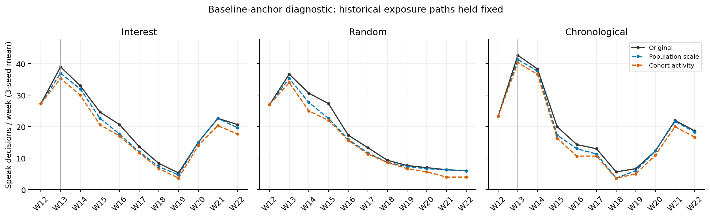

# 常态锚点换算：数值诊断方案与结果

## 对象、事实与范围

本次是固定已实现曝光轨迹的数值反事实，不是完整ABM仿真、预测曲线或因果反馈检验。使用anchored_v1的3推荐条件×3seed、每run100Agent×11周，共9900条既有决策。一次独立探索run覆盖这些记录；LLM调用与新增token预算均为零。

正式锚点来自`hypothesis_4/experiment_1/predict_anchored_utility.py`：W05–W12周均真实帖乘以22/4714，映射到固定人群activity阈值。期望人数小于0.5则B=min(activity)-0.02，其余按四舍五入人数k，取第k和k+1个阈值中点。公式是U=B+R(D-B)，U>=activity时发言。B本身不是概率。

真实用户身份与冻结人口口径相同：author主键；剔除存疑、缺失author；W12–W22中只出现一种内容类型的用户，剔除噪音。31770名五类用户对应100Agent；类型人数营销7234、悼念7056、其他6620、玩梗5943、教育4917。人口比例来自全窗，明确属于回顾性设定。

## 比较口径（在输出候选判定前固定）

1. **original**：复原旧22/4714换算与旧B，逐条重建旧判定。该组是实现核验。
2. **population_posts**：仅把旧帖子尺度22/4714改为100/31770，W05–W12的原始帖子计数、阈值映射与全部行为参数保持原样。它是最小改动的尺度对照，仍采用帖子口径；其前期分子和全窗人口分母不是严格同一用户队列，不能解释为个体活跃概率。
3. **cohort_authors**：对每类型，先固定上述全窗单类型用户队列；统计此队列W05–W12同类型每周独立活跃作者数（同周多帖只计1）。新期望人数=m_g×mean(A_g,W05:W12)/N_g，m_g为模拟Agent类型人数，N_g为真实队列类型人数。使用相同整数阈值映射。未在全窗出现、或属于多类型的前期用户不计入队列；因此结论仅适用于此回顾性固定队列。

采用UTC ISO周，与旧基准一致。缺少数据的前期周按完整工作簿该周零条记录处理，不声称采样完整。对工作簿的全平台W05–W12类别计数与冻结benchmark核对；不一致则停止，避免混入输入变化。核对人口构成与冻结统计一致。

## 复算与验收

读取每个run的原始profile（完整精度activity、spiral、spiral_scale、decay、baseline_utility）、Agent的逐周decision_log和replay分片。用replay整数曝光数/槽数重建share，用记录中的cum_own及profile参数调用正式共享纯函数重建D/R/U；不根据四位小数u推断发言。空feed按原代码share=0处理，核对实际气候。核对记录舍入误差，复原判定与decision_log.speak逐条一致，posted与replay.spoke逐条一致。原始记录已发现4次content_empty导致speak=1但posted=0，明确作为历史生成失败分账，不要求它们等于发言判定。share日志若无法精确复原或出现阈值附近误差，必须停止或明确不确定区间，不静默判定。

候选只换B；原D、R、feed、累积曝光、动作时刻固定。不把改变后的发言标志当作已生成帖子；新发言没有正文，新路径没有回流。记录每run/周/作者类型的原判定、新判定、开口→沉默、沉默→开口与效用差。同时计算各类型在R=0时的阈值人数，说明小数压零对极限常态的影响。

关键观察：全窗与W19–W22发言翻转率、三条件的玩梗人数差与份额差是否改变；份额分母变化不等于玩梗人数变化。W13悼念发言单列。结果按每seed呈现，不做显著性检验。不存在“允许多少变化就自动免重跑”的阈值；哪怕总翻转率低，也要核对关键群体与条件差。固定曝光结果稳定只能表示直接数值影响小。

可视化仅在有结果后生成一张原判定与候选判定周总数对照图，标签明确固定曝光数值诊断。输出PNG/SVG和配套CSV；不命名为正式发帖预测。

## 实现、依据与边界

本任务新增独立脚本，不修改已有代码，故不需要代码.patch。方案与最终实现由独立子agent核对，子agent不修改机器流水线。分析产物放presentation对应目录，代码、方案和人工状态放本任务。精确暂存并提交本任务改动，提交不自动推送。

依据权威等级：冻结配置、原始profile/decision_log/replay为已运行事实；benchmark为旧标定输入；工作簿与type_concentration.json为用户样本与人口口径证据；两种候选映射为本次研究者提出的诊断方案，非官方标准。工程遵循Ponytail与Karpathy Guidelines（后者上游原文https://raw.githubusercontent.com/multica-ai/andrej-karpathy-skills/main/skills/karpathy-guidelines/SKILL.md，本地未安装）。

不得依据图形是否漂亮选择B，不得改变人口、D/R参数、发言概率或时间可见性，不用留出周重新拟合。无法用事件前数据辨识的群体活动与阈值位置如实保留；人口的回顾性性质不能通过更名隐去。

## 结果

探索标识为`baseline_anchor_fixed_exposure_20261006_01`。全部9900条旧判定与decision_log.speak一致；posted与replay.spoke一致。原效用四位小数记录误差不超过0.00005。旧主批有1908次开口判定、1904次成功发布，4次content_empty单列；chronological每seed各6次空feed，共18次，按原代码零气候处理。候选均未调用LLM，未产生新的正文或反馈轨迹。

### 期望常态人数与阈值映射

| 类型 | 旧峰值换算 | 人口尺度换算 | 同队列活跃率 | R=0时人数：旧→人口尺度→同队列 |
|---|---:|---:|---:|---|
| 玩梗 | 0.009334 | 0.006295 | 0 | 0→0→0 |
| 悼念 | 0.000583 | 0.000393 | 0 | 0→0→0 |
| 营销 | 2.625159 | 1.770538 | 0.356096 | 3→2→0 |
| 教育 | 0.285267 | 0.192398 | 0.043090 | 0→0→0 |
| 其他 | 0.071754 | 0.048395 | 0.008724 | 0→0→0 |

这里的零是极限常态发言人数，B效用并不设为零。四类候选B与旧值逐字数值相同；只有营销B改变：0.82515→0.78240（人口尺度），或0.74130（同队列）。这是阈值映射的诊断结果，并不证明四类真实背景率相同。

同队列口径只纳入W12–W22单类型用户：前期营销2939个全体作者周中896个属于该队列，教育446中113、其他119中22；玩梗16、悼念1个前期作者周均不属于队列。队列匹配使分子分母相同，也显著减少前期计数。此差异与回顾性队列选择有关，不能全部归因于去掉W13峰值。

### 全部记录与后期的直接变化

| 窗口 | 旧开口判定 | 人口尺度开口／翻转 | 同队列开口／翻转 |
|---|---:|---:|---:|
| W12–W22，9900次行动 | 1908 | 1798／110 | 1688／220 |
| W19–W22，3600次行动 | 451 | 440／11 | 386／65 |

110/9900=1.11%、220/9900=2.22%，全部翻转为营销开口→沉默，没有其他类型或沉默→开口变化。以原开口判定为分母，降幅分别为5.77%、11.53%；营销判定原694次，分别减少15.85%、31.70%。不能仅用总行动占比低宣称影响可忽略。

| 旧run | 原开口判定 | 人口尺度候选 | 同队列候选 |
|---|---:|---:|---:|
| chronological_s0 | 212 | 202 | 188 |
| chronological_s1 | 219 | 207 | 198 |
| chronological_s2 | 220 | 209 | 197 |
| interest_s0 | 234 | 221 | 206 |
| interest_s1 | 229 | 217 | 204 |
| interest_s2 | 228 | 216 | 203 |
| random_s0 | 193 | 178 | 165 |
| random_s1 | 193 | 180 | 168 |
| random_s2 | 180 | 168 | 159 |

### 关键群体与推荐条件差

W13悼念判定在所有候选完全不变：interest为22/22/22，random为12/7/8，chronological为13/11/14。W13总开口人数会略减，但由营销下降造成，不能把它称为悼念峰改变。

全窗玩梗判定291次、后期286次，三候选一致。后期每seed合计玩梗人数的3seed均值：interest47.333、random5.000、chronological43.000；interest−random的均值差为42.333，未改变。

| W19–W22口径（先逐seed聚合再平均） | 原参数 | 人口尺度候选 | 同队列候选 |
|---|---:|---:|---:|
| interest玩梗／所有开口判定 | 74.40% | 76.41% | 85.12% |
| random玩梗／所有开口判定 | 18.44% | 18.94% | 24.48% |
| 两条件份额差 | 55.96百分点 | 57.48百分点 | 60.64百分点 |

份额差较旧值增加约1.51或4.68百分点，来源是营销减少改变分母；并没有新增玩梗发言。各seed的份额与人数差保存于contrasts.csv，不把这三seed称为统计显著性证据。

图：黑线原参数、蓝线人口尺度、橙线同队列活跃率；3seed均值，纵轴是开口判定数，三面板统一尺度。主曲线形态在本次数值复算中保留；候选没有新正文，不能称为新正式发帖曲线。

### 判断与下一步边界

本诊断支持：去掉W13峰值尺度后，直接影响集中在营销锚点，玩梗/悼念开口人数与interest相对random的玩梗人数优势在固定历史路径下不变。它削弱了“换锚点必然破坏主要曲线”的担忧，但不能证明完整反馈仿真也不变。

第3点可以透明完善：人口尺度候选移除了峰值参照，但仍以全窗人口为回顾性尺度、仍是帖子换算；同队列口径更贴合活跃用户率，但队列筛选包含事件后信息。两者均不可称为完全独立事件前估计，也尚未被采纳为新主方案。

第4点被确认：100人、确定性阈值使小于0.5人的背景活动全部落入零人数区间；本次不改变发言机制或人为抬高B。原参数下的营销极限背景3人是一个需解释的数值设定，而不是稳健保留的自然常量。

下一步由用户选择是否采纳一种候选、仅把诊断加入附录，或另行确定完整反馈运行。本次未重标定alpha_D/lambda，未宣称替代主批已完成，不自动启动新付费仿真。

### 验证限制与失败经验

官方intake仍被既有claims阶段阻塞；官方query-data在沙箱内外均返回SQLite disk I/O error。因此使用原始JSONL/profile/decision_log相互核对，并保留CLI回执路径在任务README；未手改harness。最初的核验发现18条空feed及4条生成空内容，已按实际旧机制处理和分账；未删记录、补正文或修改输入。绘图目视检查后统一纵轴上界，避免chronological峰值被裁切。

### English reading summary

This isolated diagnostic recomputed 9,900 historical decisions while holding exposure, fatigue and feedback paths fixed. Replacing peak normalization with population scaling changed 110 decisions; matching pre-event activity within the retrospective fixed author cohort changed 220. All changes were marketing speak-to-silence decisions. Mourning and meme decisions remained unchanged, while meme shares rose through smaller denominators. The population and cohort variants retain post-event population information and are not independent pre-event estimates. No LLM calls, new text, parameter refitting or complete counterfactual ABM trajectories were produced.
