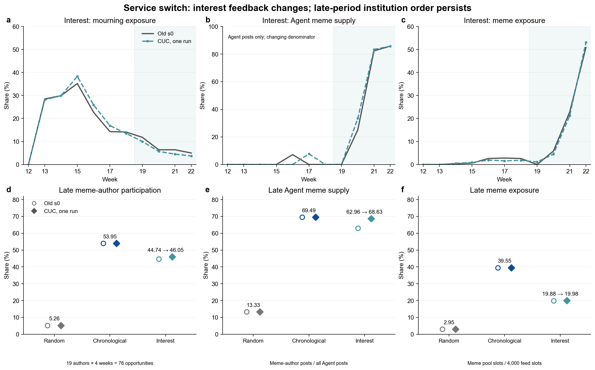

# Paired comparison of the CUC service and the previous service

**The service replacement did not reverse the principal regime ordering in this check. Text quality differs, and interest curation shows measurable feedback changes.** Numerical trajectories are identical under random and chronological curation. Late meme-author participation, Agent meme supply share and meme exposure remain ordered chronological > interest > random. This supports robustness under the frozen configuration; it does not establish model equivalence.

This is a candidate analysis inside the designated run, without formal adoption, commit or archival.

## Design, data and definitions

The new batch has 100 Agents, 11 weeks (W12–W22), and one run per regime. No explicit environment seed or model seed was supplied; the environment uses its default 0. The paired baseline consists of the three old s0 conditions in `experiment_2/runs/timestamp_v1`, whose frozen inputs were reused. Old s1/s2 runs describe an existing range only; they are not additional paired observations.

Each new regime completed 693 steps and 1100 unique Agent-week actions; environment publication totals match Agent ledgers. There are 603 posts. Supervisor and child processes have exited. The batch used603 outer body requests,0/330 additional requests, no body technical failures and no fallbacks. Three local age repairs required no model request. The3630 ceiling covers outer body requests only: SDK observe/statistics and one probe are separate. Three recovered SDK timeouts must not be erased by reporting zero body failures.

Official EDA confirmed11 environment rows and1100 Agent rows for interest, with1000 feed slots per week. ReplayReader, ENV_STATE and AGENT ledgers underpin the full comparison; see [provenance and hashes](data/source_index.json) and [integrity](data/integrity.json).

Three classifications are distinct: fixed author type determines author participation and Agent supply; feed pool labels determine exposure; lexical `assigned_type` is a text diagnostic, not semantic ground truth. Participation divides speaking Agent-weeks by all opportunities for that author group (late meme:19×4=76). Agent supply share divides by all Agent posts in the same period. Exposure divides by all external and Agent feed slots (1000 in W13;4000 in W19–W22). Late ratios pool counts across weeks rather than averaging weekly percentages.

## Numerical findings: preserved direction, local interest changes

| Regime | Posts, old → new | W13 mourning author participation | W13 mourning exposure, old → new | Late meme author participation, old → new | Late Agent meme supply share, old → new | Late meme exposure, old → new |
| --- | --- | --- | --- | --- | --- | --- |
| 随机 / Random | 176 → 176 | 2/22 (9.09%) → 同 / same | 7.90% → 7.90% | 4/76 (5.26%) → 同 / same | 4/30 (13.33%) → 同 / same | 118/4000 (2.95%) → 同 / same |
| 时序 / Chronological | 210 → 210 | 21/22 (95.45%) → 同 / same | 31.10% → 31.10% | 41/76 (53.95%) → 同 / same | 41/59 (69.49%) → 同 / same | 1582/4000 (39.55%) → 同 / same |
| 兴趣 / Interest | 214 → 217 | 21/22 (95.45%) → 同 / same | 28.50% → 28.10% | 34/76 (44.74%) → 35/76 (46.05%) | 34/54 (62.96%) → 35/51 (68.63%) | 795/4000 (19.875%) → 799/4000 (19.975%) |

W13 is the prespecified event-response week, not a presumed global peak of every curve. Interest mourning exposure peaks at W15. The [weekly appendix](data/weekly_comparison.md) and [complete series](data/weekly_metrics.csv) retain all11 weeks. W13 mourning-author participation keeps chronological=interest>random; all three late meme metrics keep chronological>interest>random.

For random and chronological, all11 environment replay scientific fields (excluding time metadata), selected numerical decision fields across1100 Agent-weeks, and ordered feed stable keys and pool labels agree. Agent text and tendency scores differ, so full prompts can still differ. Under interest,815 Agent-weeks differ in checked decision fields, but only73 change whether the Agent speaks;999 ordered feed-key sequences differ. These counts do not mean815 or999 speaking flips. A net increase of3 posts also does not mean only3 decisions changed.

Interest late Agent meme supply share increases **5.66 percentage points**: meme posts increase34→35 while all Agent posts decline54→51. Meme exposure changes only **+0.10 points**. New W13 interest mourning exposure28.1% lies below the old s0–s2 range28.5%–37.0%; late Agent meme share68.63% exceeds the old62.96%–67.21% range. Therefore, not all metrics remain within the old range. A minimum–maximum over three old runs is not a confidence interval.

Figure1. Upper panels show11-week interest trajectories; lower panels show the preserved late ordering across regimes. Old solid/new dashed conventions and percentage denominators appear in the figure; complete series are in the appendix.

### Late participation by fixed author type

Cells show old s0→new speaking Agent-weeks / all opportunities for that type. These are not unique-person participation rates or semantic content categories.

| Regime | Mourning | Meme | Education | Marketing | Other |
| --- | --- | --- | --- | --- | --- |
| 随机 / Random | 4/88 (4.55%) → 4/88 (4.55%) | 4/76 (5.26%) → 4/76 (5.26%) | 6/60 (10.00%) → 6/60 (10.00%) | 12/92 (13.04%) → 12/92 (13.04%) | 4/84 (4.76%) → 4/84 (4.76%) |
| 时序 / Chronological | 1/88 (1.14%) → 1/88 (1.14%) | 41/76 (53.95%) → 41/76 (53.95%) | 3/60 (5.00%) → 3/60 (5.00%) | 13/92 (14.13%) → 13/92 (14.13%) | 1/84 (1.19%) → 1/84 (1.19%) |
| 兴趣 / Interest | 1/88 (1.14%) → 0/88 (0.00%) | 34/76 (44.74%) → 35/76 (46.05%) | 5/60 (8.33%) → 2/60 (3.33%) | 14/92 (15.22%) → 13/92 (14.13%) | 0/84 (0.00%) → 1/84 (1.19%) |

## Generation quality: task completion is not equivalence

| Regime | First generations, old → new | Initially empty, old → new | Local age-check edits, old → new | Body rewrites, old → new | Median published characters, old → new | Published >300 chars, old → new |
| --- | --- | --- | --- | --- | --- | --- |
| Random | 176 → 176 | 1 → 0 | 0 → 0 | 1 → 0 | 216 → 175.5 | 2 → 0 |
| Chronological | 210 → 210 | 0 → 0 | 0 → 1 | 0 → 0 | 202.5 → 176 | 5 → 2 |
| Interest | 214 → 217 | 0 → 0 | 0 → 2 | 0 → 0 | 205.5 → 178 | 0 → 0 |

The old paired s0 runs contain600 first generations, with one empty response followed by a rewrite. All603 new first generations are nonempty and carry no provider refusal flag. Runtime age checks locally edited3 new texts (3/603=0.50%); old paired s0 has no such edit. Context review finds unsupported subject ages in two interest texts, whereas the chronological case more plausibly states the Agent’s own persona-consistent age and was overfiltered. Thus3/603 is an edit rate, not a subject-age hallucination rate. No new paid body rewrite or template fallback occurred. After NFKC normalization and whitespace removal, exact duplicate excess is zero within each regime for both batches; formulaic phrasing and semantic repetition are not excluded.

Published median length decreases in all regimes. A >300-character count diagnoses the prompt preference; the actual implementation limit is400, so every >300 output is not a technical failure. Raw and published texts are retained separately; length statistics use final environment publications. [Full quality statistics](data/quality_summary.json).

The fixed audit stratifies common speaking Agent-weeks by regime×five author types×W12/W13–W18/W19–W22. A stable SHA256 order selects at most two pairs per nonempty cell, giving59 pairs (118 texts). Each side is reviewed against its actual prompt, persona, first output, published output and feed. Sparse cells are not filled artificially. Only15 of59 full messages pairs are identical and44 differ. Random/chronological prompts can change through recirculated Agent text,while interest also changes feed keys. These are not59 identical-prompt model tests. Ledger anomalies are supplementary and excluded from the59-pair denominator. This is an assistant contextual audit without independent human gold labels or paid judges; it cannot estimate a population hallucination rate.

Both versions respond to seen material in the fixed sample; no sample declares death prematurely without seen support. Waiting for confirmation is a locally informed character response, not a model refusal. Unsupported subject ages in raw text change0/59→2/59 (old→new); both published samples have0/59 after processing. This exposes a difference in raw grounding, not a general capability ranking. Traceable examples follow:

- `interest:58:2026-W13`: new “才41岁” adds an age absent from the five truncated prompt items and is deleted locally. The old response conditions its comment on “若属实”. A person’s name in a source does not supply their age.
- `interest:85:2026-W13`: new “才四十出头吧” is unsupported; deletion leaves the fragment “愣了一下。吧，孩子还那么小”. The old text attributes the information to a posted notice. This separates a raw grounding issue from a processing-induced defect.
- Supplementary `new:chronological:77:2026-W13`: “三十八岁，家里也有正在读书的孩子” matches the38-year-old persona and more plausibly describes the Agent; treating it as an invented subject age is an overfilter. Supplementary `new:chronological:86:2026-W20` contains432 raw characters with inter-character spaces; the399-character publication ends mid-phrase “建 议 出”. Generation format and truncation jointly impair readability.
- `random:22:2026-W19`: the new text addresses its own Agent22 post as “@22说的…我全中”, confusing self and other. New `random:91:2026-W17` adds family circumstances resembling another user’s account. Such role/source boundaries must be distinguished from invented facts about the discussed person.
- Old text is not error-free ground truth: `random:19:2026-W17` strengthens a source’s easy-pass/600-question language into “600题保过”; `interest:61:2026-W13` turns the notice date into a claimed personal viewing memory on March24.
- Formulaic marketing and meme phrasing occurs on both sides. New `chronological:87:2026-W12` and `32:2026-W12` share a25-character opening despite no exact duplicate bodies. Conversely, the “火车头/新闻学” memes in new `interest:4:2026-W21` are grounded in seen items; creative humor should not be mechanically scored as factual error.

The quality evidence supports completion of the short-post task, not equivalence. Shorter text is not inherently worse; successfully removing an age does not ensure a natural or complete final publication. See the[full review](data/text_review_findings.md) and[pair annotations](data/text_review_annotations.jsonl).

## How text enters the numerical mechanism

The environment determines speaking from observed feed labels and frozen parameters; the LLM writes bodies after the decision. Lexical scores derived from text enter interest recommendations. Random sampling and chronological ordering do not select posts by these scores, providing a structural reason for numerical identity under those regimes. That identity is not evidence of equal language-model ability.

The earliest traceable path starts with interest Agent57 in W12: marketing tendency3.4826→3.2178 and education0.4975→0.7426. Agent80 in W13 subsequently sees1/10→2/10 education slots, with utility0.8883→1.1117; it speaks in both versions. Agent90 is the first speaking divergence: utility1.0401→0.8764, switching from publication to below-threshold silence. Exposure, supply and accumulated fatigue can propagate later changes. This is an observed path through the frozen mechanism, not proof that a single word caused all downstream changes. [Mechanism trace](data/mechanism_trace.json).

## Runtime and warranted interpretation

The new batch completed on October16,13:51:50–19:35:25 Beijing time:343.59 minutes including dispatch (about5h44m), leaving about6h16m under the12-hour guard. Old s0 took176.34 minutes from batch start through interest_s0 completion (about2h56m); new elapsed time is about1.95×. Old engine-only times are57.97/58.48/59.37 minutes, totaling175.83 minutes. [Runtime comparison](data/runtime_comparison.json). These executions occurred at different times and include service load, auxiliary calls and dispatch overhead; they do not identify intrinsic model throughput. Price was not verified.

The defensible conclusion is limited to this100-Agent service replacement check: **principal regime ordering persists; text is shorter and exhibits factual/role-boundary issues; interest feedback changes locally.** Requested alias`cuc/deepseek` returned`deepseek-v4.1-flash` and`-2/-3/-4`; the old request`deepseek-v4-1-flash-260910` returned`deepseek-v4-1-flash`. Backend identity and alias mappings are uncertain; distinct underlying foundation models cannot be assumed.

There is one new run per regime and no added seed or experiment. No repeated-run significance inference, population hallucination rate or broad capability ranking is warranted. Simulation evidence does not directly establish real-platform causal effects. The credibility/cost tradeoff of scaling to500/1000 Agents remains unresolved by this batch.

## Evidence and reproduction

- [Extraction script](extract_comparison.py), [source hashes](data/source_index.json), [paired metric deltas](data/paired_metric_differences.csv), [regime contrasts](data/institution_contrasts.csv).
- [Weekly data](data/weekly_metrics.csv), [readable appendix](data/weekly_comparison.md), [participation](data/late_author_participation.csv), [first differences](data/first_differences.json).
- [Sampling rules](data/sample_selection.json), [59 text pairs with actual feeds](data/paired_text_samples.jsonl), [review annotations](data/text_review_annotations.jsonl), [review findings](data/text_review_findings.md), [supplementary anomalies](data/supplementary_anomaly_samples.jsonl).
- [Synthesis](synthesis_report_en.md), [editable SVG](assets/figure_01_model_comparison.svg). Commands and original paths are recorded in source_index. Outputs stay inside this run; formal mechanisms, configuration and the main pipeline are unchanged. H4 remains the research hypothesis;4_cuc is an isolated analysis namespace. Specific claims have not received item-by-item user approval; formal release signatures remain unsigned and no validate-synthesis/pipeline completion is asserted. This boundary does not negate verified evidence or require approval of additional work for candidate delivery.
