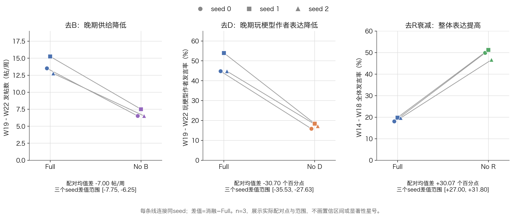
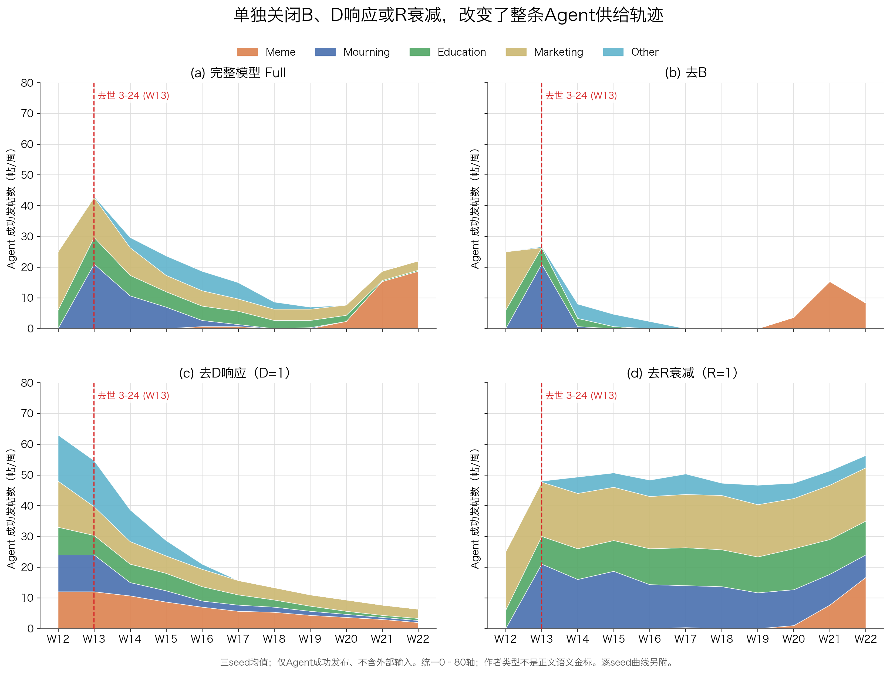
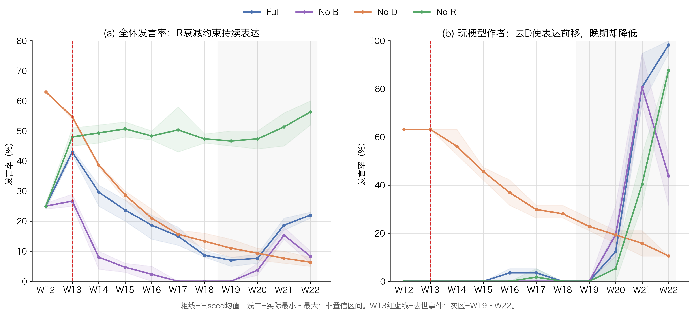

# B、D、R消融：timestamp-interest同seed配对分析
结论仅限本组冻结仿真；n=3，复用Full的分批与API差异仍可能影响生成反馈。

## 1. 范围与数据

本分析只回答冻结的timestamp兴趣制度内B、D、R的作用。Full为主实验timestamp_v1_interest_s0/s1/s2，九次消融使用相同seed对应的外部样本、人口、门槛、行动表和科学配置；规范化操作路径后，只差指定组件参数。三个seed实际使用同一人口和行动表，不能视为三个人口样本。

12次均完成693步、100人×11周=1100次机会；合计13,200次机会，3,309次speak=true且全部成功发布，9,891次below_threshold，空feed及行动/生成/发布失败均为0。九次消融发布2,652条、外层模型请求2,657次；本轮分析没有新增模型请求。已逐run用官方CLI查询replay，并与环境逐周计数及每个Agent的决策记录交叉核对。

配对单位是seed。预设三项主指标：B用W19–W22每周成功发布数（先在run内取4周均值）；D用W19–W22玩梗型作者speak=true / 76次机会；R用W14–W18全体speak=true / 500次机会。所有差值为消融−同seed Full。只有3对，列实际差值与最小–最大，不报告显著性、置信区间，也不将周或行动当作独立重复。

完整模型与消融分批运行；本run中API从coding/v3变为plan/v3，请求模型固定deepseek-v4-1-flash-260910，但Full及较早消融返回deepseek-v4-1-flash，较晚消融返回完整版本ID。Full计划只保存服务host，未保存可完整核查的API路径。相同请求模型与冻结代码/输入不证明后台模型和随机生成完全一致。这是复用对照的剩余限制，不能通过同seed标签消除。

| seed | Full | No B | No D | No R |
|---|---|---|---|---|
| 0 | 214 / 214 | 88 / 88 | 275 / 275 | 521 / 522 |
| 1 | 227 / 228 | 100 / 101 | 278 / 279 | 535 / 535 |
| 2 | 216 / 216 | 94 / 94 | 255 / 257 | 506 / 506 |

表中每单元为11周成功发布数 / 外层模型请求数。

## 2. 预设指标的配对结果

三个预设指标的方向在三个seed中一致。B的晚期供给均值由13.83降至6.83帖/周；去D后晚期玩梗型作者发言率由47.81%降至17.11%；去R衰减后W14–W18整体发言率由19.13%升至49.20%。下表列出均值及三个配对差值，百分比之差使用“百分点”。

| 指标 | Full均值 | 消融均值 | 平均差 | 三个配对差值范围 |
|---|---|---|---|---|
| B：晚期帖/周 | 13.83 | 6.83 | -7.00 | [-7.75, -6.25] |
| D：晚期玩梗作者发言率(%) | 47.81 | 17.11 | -30.70 | [-35.53, -27.63] |
| R：事件后全体发言率(%) | 19.13 | 49.20 | +30.07 | [+27.00, +31.80] |

| seed | B：帖/周 / posts/week | D：百分点 / pp | R：百分点 / pp |
|---|---|---|---|
| 0 | 13.50 → 6.50 (-7.00) | 44.74 → 15.79 (-28.95) | 18.00 → 49.80 (+31.80) |
| 1 | 15.25 → 7.50 (-7.75) | 53.95 → 18.42 (-35.53) | 19.80 → 51.20 (+31.40) |
| 2 | 12.75 → 6.50 (-6.25) | 44.74 → 17.11 (-27.63) | 19.60 → 46.60 (+27.00) |

图2：预设三指标的同seed配对。每条线连接相同seed，差值均为消融−Full；范围不是置信区间。

## 3. B：维持退潮后的表达底座，也保留非玩梗供给

去B后的晚期总供给下降7.00帖/周，三个seed的差值为-7.00、-7.75、-6.25。晚期每run四周内，非玩梗型作者供给从平均19.00条变为0；玩梗型作者也从36.33条降至27.33条。其晚期份额却由65.61%升至100%。因此，“份额更高”在这里来自其他类型清零，不能写成玩梗型作者产量增加。

这与U=B+R(D−B)的结构一致：同一状态下Full相对去B的差为(1−R)B，R=1时B权重为零。已发生W12记录的同Agent数值审计显示三个seed均R=1、Full与去B的在记录精度内U和发布决策一致；后续闭环分叉才逐步显现。B不是独立于R的固定加分，其作用随R衰减而增强。

| 条件 / condition | Meme | Mourning | Education | Marketing | Other | Meme作者份额 / author share |
|---|---|---|---|---|---|---|
| full | 36.33 | 0.33 | 5.00 | 13.00 | 0.67 | 65.61% |
| no_b | 27.33 | 0.00 | 0.00 | 0.00 | 0.00 | 100.00% |
| no_d | 13.00 | 3.67 | 4.00 | 13.67 | 0.00 | 39.14% |
| no_r | 25.33 | 40.67 | 47.33 | 68.33 | 20.00 | 12.56% |

表：W19–W22四周累计帖数的三seed均值；份额为各run先求份额再取均值。

图1：三seed均值的作者类型供给。复用指定模板五色、W13事件线和0–80轴；只含Agent成功发布，逐seed单图见附录。

## 4. D：调节表达时机及晚期选择性，不是单向增加总量

去D是令D=1，并非令D=0。全窗口总供给反而从Full平均219.00条升到269.33条，但晚期玩梗型作者发言率平均下降30.70个百分点，晚期其成功发帖量从36.33条降至13.00条。它没有消灭晚期发言，不能声称D是所有晚期表达的必要条件。

过程证据显示，去D后W12和W13各平均有12位玩梗型作者发言，而Full这两周均为0；去D把表达前移，随后逐步回落。到晚期，该群体实际阅读中的玩梗标签份额由25.18%升至31.18%，累计同类接触均值由2.36升至11.45，R均值从0.835降至0.414，晚期发言却更少。这支持“时序门控—生成反馈—累计接触衰减”的闭环解释；不是对这条中介路径的独立识别，也不能只归结为一个当周D均值。

早期“玩梗型/悼念型作者发言”并不自动意味着当时就在发布相应语义的正文。例如去D的W12悼念型作者共发36条，其中现有词表将29条判为marketing、7条判为mourning；这只说明作者标签与词表判类不同，不构成对提前悼念或事实幻觉的人工裁定。

| 条件 / condition | Meme标签阅读 / exposure | 累计同类 / cum. own | R均值 / mean | D均值 / mean | 晚期Meme作者发言 / speaking |
|---|---|---|---|---|---|
| full | 25.18% | 2.36 | 0.835 | 1.009 | 47.81% |
| no_b | 29.17% | 2.45 | 0.832 | 1.049 | 35.96% |
| no_d | 31.18% | 11.45 | 0.414 | 1.000 | 17.11% |
| no_r | 13.11% | 1.10 | 1.000 | 0.835 | 33.33% |

图3：全体与玩梗型作者的发言率轨迹。粗线为均值、浅带为三个seed实际最小–最大，不是统计置信区间。

## 5. R：约束持续高供给，并参与晚期群体优势的重排

去R衰减令R=1，W14–W18全体发言率提高30.07个百分点，三个seed分别为+31.80、+31.40、+27.00个百分点。晚期全体供给也由13.83升至50.42帖/周；悼念型作者在W18仍平均发13.67条，而Full为0。因而累计同类接触的衰减机制，对本配置下的事件后总体退潮有明显约束作用。

去R并未让所有类型都更活跃。晚期玩梗型作者每run四周发帖从36.33降至25.33条，份额由65.61%降至12.56%；其阅读中的玩梗标签份额由25.18%降至13.11%，D均值由1.009降至0.835。持续的教育、营销、悼念及其他作者供给占据了更多空间。这些是闭环联合变化，不能从总量上升推断每一群体都上升。

R度量累计同类接触的影响，不是仅按日历时间自动变小。且R=1使U=D，B的系数也同时归零。因此本比较检验的是“衰减并向B回归”的整套机制，不是保持B贡献不变的正交R效应。

## 6. 能够支持的结论与边界

在这组冻结的timestamp-interest参数和输入下，结果支持：B维持退潮后的供给与一定类型多样性；D响应参与早期抑制和晚期选择性表达；R的接触衰减限制事件后的持续高供给，并与B、D共同改变作者类型构成。三项不能相加为贡献率；单因素消融允许后续feed、接触与正文自然分叉，得到的是闭环总变化。

不能据此声称B、D、R在现实世界或所有策展制度中均为必要条件，不能声称偏好发生普遍转变，也不能声称所有玩梗型作者生成文本均被独立确认是玩梗。主图的类型恒为固定作者类型（pool_type）；实际阅读标签和现有四词表assigned_type另行列出，词表也不是人工语义金标。

局限还包括n=3、相同人口/调度表、单一interest制度、保留的17条历史池与W13条件化机会安排、B尺度/floor及既有门槛、温度为1的随机生成、分批API/服务端漂移。未新增LLM、同期Full或组合消融，也没有额外模型审稿。当前是本run内可复核的候选分析，未替用户批准新结论，未落地主项目。

## 真实正文分叉例示与证据

### B: seed0, Agent13, 2026-W19 (marketing)

full: U=0.8650, threshold=0.7958, R=0.1500, D=1.0910

> 刷到@58和@13在聊信息差，说句实在的：把坑提前讲明白，确实不等于替你走完路，升学不是做对几道题就能改命，方向、分数、家里的底子得放一块儿算。

但另一面也得说：连有哪些选项都不知道，谈“看孩子自己”就有点奢侈。我这几年干的就是把这些摊开讲——院校专业梯度怎么排、不同分数段怎么搭、哪些项目千万别碰，讲清楚，再让孩子自己选，这两件事不冲突。

最近整理了一份志愿填报避坑思路，评论区扣“信息”我发你，想听直播拆解也可以说一声。别等出分那几天才慌。

no_b: U=0.2381, threshold=0.7958, R=0.2192, D=1.0862

> 未发帖（低于门槛）

### D: seed0, Agent12, 2026-W20 (meme)

full: U=0.9795, threshold=0.9445, R=0.7676, D=1.0413

> 刷到张雪峰那句"我倒要看看你儿子报不报新闻学"，我整个人：这孩子的志愿填报能不能开个直播[吃瓜] 全程无广，纯真人秀。

然后同框又刷到个"雪糕怎么发紫 看我三口一个#张雪峰"，好家伙这紫雪糕怕不是新闻学专业毕业的，被问急了。

再往下滑，六升七暑假计划表比我打工排班还满……六升七，升完七还得升八，建议一步到位升到退休[裂开] 准初一的爹妈先放过孩子也放过自己吧。

（至于刷到悼念帖那种，这会儿就不抖机灵了，安静划过。）

no_d: U=0.8534, threshold=0.9445, R=0.3471, D=1.0000

> 未发帖（低于门槛）

### R: seed0, Agent30, 2026-W14 (mourning)

full: U=0.9864, threshold=1.0399, R=0.4055, D=1.3069

> 未发帖（低于门槛）

no_r: U=1.3069, threshold=1.0399, R=1.0000, D=1.3069

> 刷到几条相关帖子，有讣告、殡仪馆外排队的描述，也有“走了”这个词。但我看到的来源多是转述或标注未核实，没法替谁确认。真正让我停下来的是留言里的那些话：考研二战的晚上靠直播撑过去，普通家庭的孩子少走弯路。争论之外，有人确实被那些直白的话托住过。别让未经证实的图再跑来跑去；还在熬的人，也别硬扛，先照顾好自己。

以上按预先声明的分叉条件、seed/周/ID排序取首例，非随机样本，不用于估计效应。完整定位和正文见data/illustrative_examples.json；作者类型不替代正文语义。

## 附录：逐seed图与复核材料

- seed0: [full](assets/chart_01_full_s0_agent_supply.png) · [no_b](assets/chart_01_no_b_s0_agent_supply.png) · [no_d](assets/chart_01_no_d_s0_agent_supply.png) · [no_r](assets/chart_01_no_r_s0_agent_supply.png)
- seed1: [full](assets/chart_01_full_s1_agent_supply.png) · [no_b](assets/chart_01_no_b_s1_agent_supply.png) · [no_d](assets/chart_01_no_d_s1_agent_supply.png) · [no_r](assets/chart_01_no_r_s1_agent_supply.png)
- seed2: [full](assets/chart_01_full_s2_agent_supply.png) · [no_b](assets/chart_01_no_b_s2_agent_supply.png) · [no_d](assets/chart_01_no_d_s2_agent_supply.png) · [no_r](assets/chart_01_no_r_s2_agent_supply.png)

- [paired_differences.csv](data/paired_differences.csv)
- [paired_summary.csv](data/paired_summary.csv)
- [run_metrics.csv](data/run_metrics.csv)
- [weekly_by_type.csv](data/weekly_by_type.csv)
- [weekly_exposure_by_cohort.csv](data/weekly_exposure_by_cohort.csv)
- [vocab_label_counts.csv](data/vocab_label_counts.csv)
- [illustrative_examples.json](data/illustrative_examples.json)
- [source_index.json](data/source_index.json)

离线候选分析：未新增LLM调用、未调用独立模型reviewer，未将新结论标为用户批准；未落地或提交主项目。
