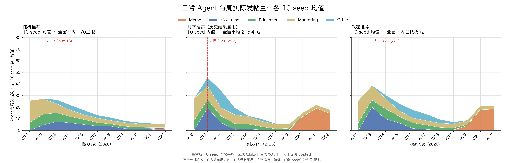
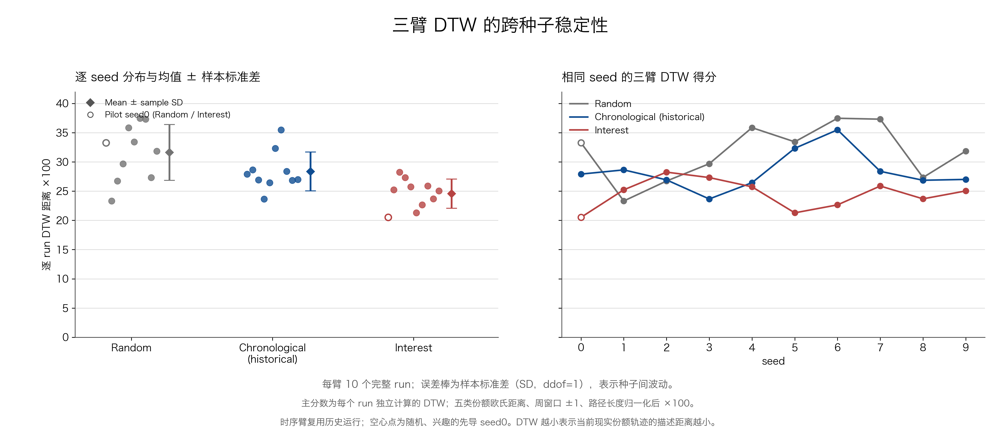

# 三臂各10seed的小时回流比较

本次结果支持：**在当前冻结设置中，兴趣臂对现实五类构成走势的平均拟合最好，跨seed波动也最小；这一平均排序较稳定，但不是每个seed都由兴趣胜出。**这不等于兴趣臂的玩梗传播量最大，也不能据此证明所有设置下兴趣都最优。

## 三臂均值图

沿用之前Agent发言量chart3b的五类配色、W13事件线和统一0–80帖纵轴。先按每个seed、每周统计固定作者类型的成功发帖数，再对10个seed等权平均；不包含外部注入、官方帖或历史池。每周总量是五类之和，图中小数来自均值，不代表单次实验发出了小数条帖子。

随机、时序、兴趣的全窗W12–W22平均发帖量分别为170.2、215.4、218.5帖，对应10seed总量1702、2154、2185帖。

## DTW与稳定性

DTW（动态时间规整）允许相近周次对齐，用来衡量仿真与现实五类份额随时间变化的差距；数值越小，表示在这个指标上越接近现实。主表**先独立计算每个run的DTW，再汇总10seed**；“±”是样本标准差，表示种子间波动，不是置信区间。

| 制度 | DTW×100，均值±样本标准差 | 最小–最大 | 逐seed三臂第一名次数 |
|---|---:|---:|---:|
| 随机 | 31.629 ± 4.781 | 23.315–37.471 | 2/10 |
| 时序（历史完整结果） | 28.368 ± 3.313 | 23.662–35.495 | 1/10 |
| 兴趣 | **24.559 ± 2.506** | 20.518–28.253 | **7/10** |

兴趣相对于随机、时序各有8/10个seed的DTW更低；时序相对于随机也有8/10个seed更低。兴趣减随机的配对差均值为−7.070，兴趣减时序为−3.808。这里的比较单位是完整seed运行，不把11周或100名Agent当成独立重复。

反例均保留：seed1、seed2由随机第一，seed3由时序第一；兴趣在seed2排第三。因此，三臂不是每个seed都呈现“随机→时序→兴趣”逐层改善。

| seed | 随机 | 时序 | 兴趣 | DTW最低 |
|---:|---:|---:|---:|---|
| 0 | 33.280 | 27.917 | 20.518 | 兴趣 |
| 1 | 23.315 | 28.638 | 25.224 | 随机 |
| 2 | 26.726 | 26.930 | 28.253 | 随机 |
| 3 | 29.692 | 23.662 | 27.324 | 时序 |
| 4 | 35.862 | 26.445 | 25.740 | 兴趣 |
| 5 | 33.438 | 32.328 | 21.288 | 兴趣 |
| 6 | 37.471 | 35.495 | 22.651 | 兴趣 |
| 7 | 37.313 | 28.389 | 25.876 | 兴趣 |
| 8 | 27.335 | 26.863 | 23.682 | 兴趣 |
| 9 | 31.858 | 27.009 | 25.037 | 兴趣 |

### 排序是否由个别seed或模型版本造成

| 检查范围 | 随机均值 | 时序均值 | 兴趣均值 | 平均排序 |
|---|---:|---:|---:|---|
| 全10seed | 31.629 | 28.368 | 24.559 | 兴趣＜时序＜随机 |
| 去掉已经观察过的先导seed0，剩9seed | 31.446 | 28.418 | 25.008 | 兴趣＜时序＜随机 |
| 三臂实际模型标识完全相同的seed3–9，剩7seed | 33.281 | 28.599 | 24.514 | 兴趣＜时序＜随机 |

另做10次“每次去掉一个seed”的检查，平均排序全部保持兴趣＜时序＜随机。去掉先导seed0后兴趣6/9次第一，同实际模型7seed中兴趣6/7次第一。这些检查支持平均结论不依赖某一个seed；它们彼此重叠，不是额外的独立实验，也未进行显著性推断。

**均值轨迹DTW另列**：先对10个seed的每周份额向量取均值，再计算一次DTW，随机26.234、时序22.866、兴趣20.284。这与主表的“10个独立DTW的均值”是两种运算，不能混用；图中的DTW分布和误差棒使用主表口径。

## 玩梗传播量是另一个目标

下表均为各10seed的逐run指标等权均值；份额先在每个run内计算再平均。

| W19–W22指标 | 随机 | 时序 | 兴趣 |
|---|---:|---:|---:|
| 玩梗型作者成功发帖数 | 2.6 | **45.4** | 40.5 |
| 同窗全部成功发帖数 | 27.0 | 60.5 | 58.8 |
| 玩梗型作者发帖份额 | 9.23% | **75.01%** | 68.94% |
| 实际feed中玩梗标签曝光次数 | 140.0 | **1728.6** | 1023.7 |
| 实际feed中玩梗标签曝光份额 | 3.50% | **43.22%** | 25.59% |

每run该窗实际feed槽位均4000。作者类型的供给份额与feed标签曝光是两种口径，分别核对，没有用其中一种替代另一种。时序在这些晚期玩梗传播指标上更高，兴趣则在五类全窗走势的DTW上更低。因此，“兴趣拟合较好”不能写成“兴趣对所有传播目标都最好”。

## 来源、计算口径与核验

本方案已获用户授权采用到正式主工作区。本次分析仅离线读取30个完整run：随机/兴趣各复用先导seed0，加本次新完成seed1–9；时序读取原主实验完整seed0–9。撤回的部分时序不进入结果、分母或图，旧周回流随机/兴趣、组件消融也不纳入。落地没有重跑仿真、发模型请求或调参；论文正文未修改。

历史时序10seed的完成状态、配置、输入、实际提示来源、模型、回流与原始哈希已逐项审计，见[正式矩阵及复用来源](../../../hypothesis_4/experiment_2/runs/hourly_return_v1/manifest.json)。时序seed0–2的正文实际返回为`deepseek-v4-1-flash`，seed3–9为`deepseek-v4-1-flash-261017`；本次随机/兴趣全为后者。前三个旧别名不能当作严格同返回版本，所以上文单列后三者同版的7seed结果。历史时序的新旧回流路径等价已核对；本比较仍是完整推荐制度比较，不能把差异全部解释成纯排序效应。

主效标使用上海自然周W12–W22的全量现实非噪音五类份额，共44,694条；不是仅250条注入样本。五类顺序为玩梗、悼念、科普、营销、其他。作者类型为冻结profile的固定类型，不是对生成正文重新做独立语义分类；现实效标与注入样本同源，所以DTW是描述拟合，不是独立留出预测的准确率。

DTW沿用先前定义：11周五维份额向量，局部欧氏距离，±1周约束，不做z标准化；先选最小累计距离路径，平局按对角、上、左，之后除所选路径长度并乘100。它不是直接优化平均代价的另一种算法，也不能把24.559解释为平均每类24.559个百分点的误差。上海周为主分析，UTC周结果及全部对齐路径保存在[路径文件](results/dtw_paths.json)。

30run全部核对693步、1100条唯一环境行动与Agent决策、100名Agent、11周、正文和模型；原始Agent逐周五类供给、曝光与官方replay一致，发布入池守恒，未来或同批新帖曝光均0。共核对3000份Agent、33,000条决策与6041次成功发帖。两次分析（含`--check`）的7份输出确定性一致；[落地前独立核验](verification/independent_verification.original.json)不导入生产DTW或分析器，另从原始记录重建供给，用标准库独立求解DTW，最大数值差为1.07×10⁻¹⁴。两张PNG已实际查看。正式路径重新分析及`--check`均通过；[落地一致性核验](verification/landing_comparison.json)确认四份科学数据和两张PNG逐字节一致，run_metrics仅时序来源描述更新，summary仅范围说明、效标路径和合约哈希更新，科学字段保持。首次读取缺少时序replay碎片SHA的失败日志与补齐说明保留在[核验目录](verification/README.md)。

主数据见[330行周表](results/weekly.csv)、[30run指标](results/run_metrics.csv)、[配对差值](results/paired_dtw.csv)、[完整汇总](results/summary.json)；[来源哈希及逐run核验](results/provenance.json)和[图件来源清单](assets/plot_manifest.json)保留可追溯证据。正式复算命令见[分析入口](README.md)。落地保留原数值，运行路径、正式合约哈希与来源清单改指正式位置；不覆写旧周回流结果。

当前证据支持本设置下兴趣臂有较稳定的平均拟合优势；尚不能证明新版比旧周回流方案的跨seed稳定性提高，也没有完成组件消融或普遍最优性的验证。
