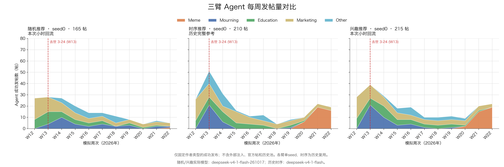
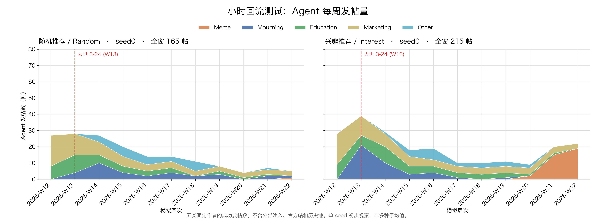

# Agent每周发帖量对比

当前增加三臂比较：随机/兴趣使用本次小时回流seed0，时序按用户最新要求复用历史完整seed0，并明确标注模型版本差异。DTW以接近现实五类周构成为目标，兴趣20.52、时序27.92、随机33.28，越低越贴近。完整解释见[三臂报告](three_arm_report.md)。撤回的不完整时序不参与结果或DTW；原两臂图及其来源保留。

沿用用户之前指定的chart3b五类堆叠面积图：从底到顶为玩梗、悼念、教育、营销、其他，原配色、W13事件线及0–80帖纵轴保持一致。



| 三臂新增资产 | 用途 |
|---|---|
| [three_arm_report.md](three_arm_report.md) | 当前结果、DTW方法、时序复用依据与限制 |
| three_arm_supply_comparison.png / .svg | 三臂并排绝对数量图，时序标注历史参考 |
| three_arm_dtw_comparison.png / .svg | 对现实五类周构成的DTW距离比较，越低越贴近 |
| three_arm_weekly.csv | 33行实际周发帖数量与五类份额 |
| three_arm_results.json | 三臂指标、DTW路径与局部代价、原始来源及复用核验 |
| three_arm_contract.json | 分析范围、上海周主效标、既有DTW定义及120份冻结来源；不改变执行授权 |
| three_arm_outputs.json | 六份三臂数值/图件产物的实际SHA256 |
| dtw_verification.json | 独立枚举336对短序列、11248条合法路径，并用另一实现从300份Agent原始记录复算三臂DTW |
| [inputs/](inputs/README.md) | 必要历史时序原始快照、现实效标和DTW函数 |

离线重算：从本run目录执行`/Users/easylife/Project/AgentSociety/AgentSociety2/.venv/bin/python pilot/compare_three_arms.py`；相同命令加`--check`只复算核对，不覆盖既有产物。三臂各100名Agent×11周成功发帖已与环境和官方replay逐周逐类核对；图件PNG已实际查看。确定性复算与独立算法/数值核验均通过，未发送模型请求。

## 原两臂图



| 资产 | 用途 |
|---|---|
| [agent_supply_comparison.png](agent_supply_comparison.png) | 300dpi两臂并排对比图 |
| [agent_supply_comparison.svg](agent_supply_comparison.svg) | 可缩放矢量图 |
| [weekly_agent_supply.csv](weekly_agent_supply.csv) | 22行实际周发帖量，按五类固定作者分类 |
| [manifest.json](manifest.json) | 样式定义、输入与输出SHA256、200份Agent原始记录的核对结果 |

统计的是成功发布的`posted`，排除外部注入、官方帖与历史池，不按正文语义重新分类。全窗随机165帖、兴趣215帖；W19–W22玩梗型作者分别1帖、36帖。这是单seed的初步观察，不作显著性或跨seed稳定性判断。

来源为[已验收分析周表](../analysis/weekly.csv)及[原始结果快照](../results/README.md)。绘图前独立读取两臂共200份Agent决策，逐周逐类核对，并与分析来源SHA256校验一致。历史图只提供样式，不提供本次数据。

从本run目录离线复算（不启动仿真或发送LLM请求）：

```bash
/Users/easylife/Project/AgentSociety/AgentSociety2/.venv/bin/python pilot/plot_agent_supply.py
```

绘图脚本为[plot_agent_supply.py](../plot_agent_supply.py)，复用同目录plot_pilot.py的选臂与汇总检查。仅新增绘图资产，原分析产物保持不变；正式论文和历史图未修改。
