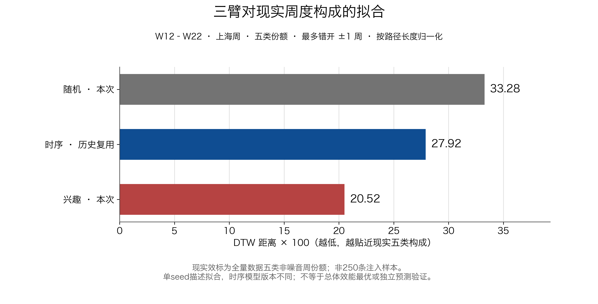

# 三臂对比与DTW现实轨迹拟合

按“更贴近现实五类内容的周度构成”衡量，本次兴趣臂的DTW最低，其次时序、随机。该结论仅针对本组三条seed0轨迹；时序复用历史完整结果，未新跑或接续已撤回的时序。

| 指标 | 随机：本次 | 时序：历史完整参考 | 兴趣：本次 |
|---|---:|---:|---:|
| DTW距离×100，越低越贴近现实 | 33.2796 | 27.9168 | 20.5180 |
| 全窗成功发帖 | 165 | 210 | 215 |
| W19–W22玩梗型作者发帖 | 1 | 41 | 36 |
| W19–W22全部发帖 | 24 | 59 | 62 |
| 同窗玩梗型作者供给份额 | 4.17% | 69.49% | 58.06% |
| 同窗玩梗标签实际曝光 | 135/4000 | 1582/4000 | 870/4000 |
| 同窗玩梗标签曝光份额 | 3.38% | 39.55% | 21.75% |

兴趣的现实轨迹拟合误差最小，但时序的晚期玩梗型作者发帖及标签曝光更高。因此本次支持“兴趣更接近现实构成”，不能将“效果最好”解释为所有指标都最高。没有统计显著性检验，也不把DTW距离×100解释成每一类的平均百分点误差。

## DTW怎样计算

DTW（动态时间规整）允许两条时间曲线略微错开后再比较，例如允许模拟W20对应现实W21，最多错开一周。沿用项目既有`plot_dtw_validation.py::constrained_multivariate_dtw`函数，未执行其写死旧结论的main。

- 比较W12–W22，每周同时包含玩梗、悼念、教育、营销、其他五个占比；五类共用一条时间对齐路径。
- 模拟占比为各固定类型作者成功发帖数÷当周全部Agent成功发帖数，不含外部注入、官方帖或历史池。
- 现实使用上海周的全量五类非噪音内容，共44,694帖；剔除噪音后各周重新归一化。不是250条注入样本。
- 每对周的代价为五维占比向量的欧氏距离，不做z标准化。寻找累计代价最低的±1周受限路径，同累计代价时依次偏好对角、上、左。
- 最后以累计代价÷该路径格数×100报告。它是对最小累计代价路径作事后长度归一化，不是直接寻找平均代价最低的路径。

随机最优路径12格；时序和兴趣各11格，后两者的最优路径恰好逐周对齐。完整路径与各格代价保存在`three_arm_results.json`。主结果按上海周计算，与仿真时钟一致。保留旧UTC周作为副分析，随机33.2786、时序27.7274、兴趣20.5019，排序一致；不以更有利的周边界选择主结果。

复算`--check`通过。独立核验另穷举336对短序列的11,248条合法路径，并从300份Agent原始记录和现实整数计数，用另一种实现重建份额与计算DTW；三臂数值、路径及排序全部一致，见`dtw_verification.json`。

## 时序复用依据与限制

来源为正式主实验`timestamp_v1_chronological_s0`，已冻结必要原始文件到本目录`inputs/chronological_s0/`。实际核对100名Agent、1100个唯一Agent×周行动和决策、693步、11周、210次成功发布；三臂所有五类周发帖数均与官方只读replay查询一致，回流审计通过。

历史时序配置与本pilot对应配置，只差请求保护账本/额度及新增回流策略声明，剔除这些字段后逐字段相同；实际100人profile剔除请求保护字段后相同。旧时序本身已按小时批末回流，既有693批离线测试验证新声明不改变其行为。本次撤回时序的107条有效决策与历史结果逐项相同，撤回产生的失败记录与不完整轨迹未计入结果或DTW。

随机、兴趣实际正文模型为`deepseek-v4-1-flash-261017`；历史时序为`deepseek-v4-1-flash`，旧请求标识为`deepseek-v4-1-flash-260910`。这些不是严格相同的返回版本。本比较沿用项目此前将既有版本视为研究等价的约定，但保留模型影响尚未完全排除的限制，不能称为本批同模型三臂重跑。

现实指标按正文标签分类，模拟指标按固定作者类型分类，二者不是完全一致的独立文本编码；现实效标与注入样本同源。本结果是描述性的模式拟合，不是独立预测验证，不证明普遍最优，也不单独识别排序的因果效果。

来源、方法、路径与复算入口见[本级README](README.md)。本次没有新仿真、模型请求、调参、commit/push、正式落地或论文修改；原两臂执行计划、状态、预算账本和分析产物保持。
