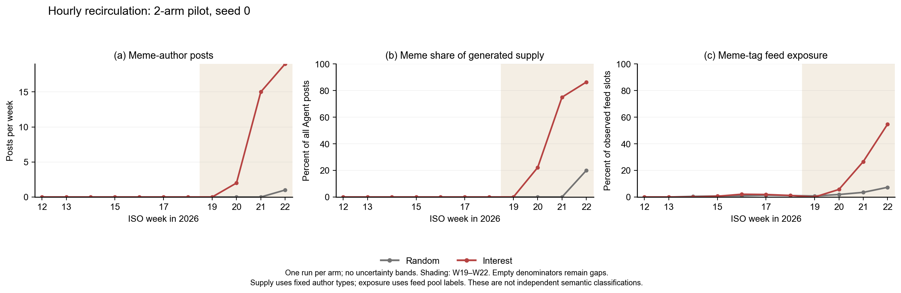

# 小时回流随机与兴趣两臂seed0试运行观察

随机与兴趣两臂均从W12初始状态新运行；每臂100人、11周、693批、1100次行动。实际正文返回模型为`deepseek-v4-1-flash-261017`。
本次只有一个seed，结果用于观测当前规则的运行表现，不作显著性检验或跨seed稳定性判断。

主要窗口固定为W19–W22。晚期玩梗型作者发帖数量为兴趣最高，其供给份额为兴趣最高。数量与份额分别列出，不能只凭份额判断产量。

| 制度 | 全窗总发帖 | 晚期玩梗作者发帖 | 晚期总发帖 | 晚期玩梗作者份额 | 晚期玩梗标签曝光份额 |
|---|---:|---:|---:|---:|---:|
| 随机 | 165 | 1 | 24 | 4.17% | 3.38% |
| 兴趣 | 215 | 36 | 62 | 58.06% | 21.75% |

图：随机与兴趣的玩梗型作者发帖数量、供给份额和实际feed标签曝光；阴影为固定W19–W22窗口，仅单seed观察。

曝光统计直接汇总实际行动feed，分开标记外部真实帖和Agent生成帖；分母为实际曝光条数。

| 制度 | 晚期全部曝光条数 | 其中Agent帖 | Agent帖中玩梗标签份额 | 玩梗作者所见玩梗份额 | 非玩梗作者所见Agent玩梗份额 |
|---|---:|---:|---:|---:|---:|
| 随机 | 4000 | 1663 | 0.24% | 3.16% | 0.06% |
| 兴趣 | 4000 | 1501 | 25.72% | 26.32% | 9.63% |

随机与兴趣两臂小时回流审计均通过：生成帖可用时刻与发布时间一致，同批生成帖曝光为0，未来曝光为0，发布与入池数量守恒。这里的入池不等于每条帖子必定被推荐。

作者类型是初始化固定身份；供给指标按成功posted计数，不是独立语义判定。feed中的玩梗标签是模型使用的pool type；Agent帖标签来自作者类型，外部帖沿用冻结输入标签。曝光接触也不等于证明全文理解。

本次只比较统一回流下2套完整制度。生命周期、保底、兴趣抽样等原有制度差异保持，不能把臂间差异单独归为排序效应。结果不证明任何制度在所有目标下最优，也不据本seed结果调整参数。

所选制度正文外层请求合计380次；已中止排除制度消耗30次，预算累计410次。这不是全部SDK请求量或token账单。逐run来源哈希、模型计数和回流审计见summary.json，逐周曲线数据见weekly.csv。

时序已按用户指示中止，其不完整轨迹不进入供给、曝光、排序或图表比较；本次没有自动搬入旧时序结果。
